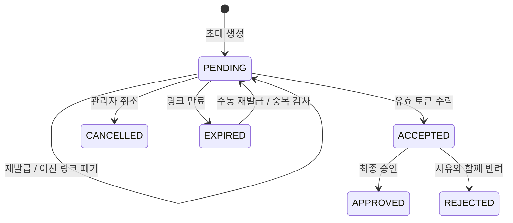

# 기반 기능 API 계약

2026-10-26: 현재 상품 정책은 SRS v1.1의 물리 삭제 미제공·판매 중지/재개이며 OpenAPI `0.1.4-product-retention`에 반영했다. 구현된 M1 본인 닉네임 저장과 현재 사용자 응답·타입 동기화는 [profile-api.md](profile-api.md)를 따른다. `PATCH /me/profile`은 계정 version을 사용하며 이메일·사진 변경을 허용하지 않는다.

작성일: 2026-10-23. 갱신일: 2026-10-26. 목표 계약은 [openapi.json](openapi.json), 확정 정책 Q1~Q12는 [decisions.md](decisions.md)를 따른다. 서버에 이미 구현된 endpoint와 혼동하지 않는다. base URL은 동일 origin의 `/api`다.

## 공통 요청·응답

- 세션 쿠키 `SESSION`: HttpOnly, SameSite=Lax, 운영 HTTPS Secure. 쿠키 Path는 `/`, 프록시 `/api` 환경에서 실제 전달·삭제를 검증한다. 프론트는 `credentials: include`를 사용하고 세션 ID를 읽거나 저장하지 않는다.
- 상태 변경은 `X-CSRF-Token` 필수. 먼저 `GET /auth/csrf`의 `{token}`을 읽는다. 로그인·로그아웃·초대 수락 이후 다시 발급받는다. 세션이 이미 없는 로그아웃만 예외다.
- 정상 DTO는 별도 data wrapper 없이 반환한다. 페이지는 `{items:[],meta:{page:1,pageSize:20,total:0}}`. 데이터가 없는 것은 정상 빈 배열이며 서버 실패를 빈 데이터로 바꾸지 않는다.
- 모든 보호 응답·토큰·초대 응답은 `Cache-Control: no-store`, 모든 응답은 `X-Request-ID`. 오류 본문의 requestId와 서버 로그를 연결한다.
- ID는 문자열, API version은 DB+1. 응답의 `createdAt/updatedAt/asOf`는 UTC ISO 8601. `snapshotVersion`은 캐시 비교용 불투명 값이며 쓰기 version이나 일관된 DB 전체 snapshot을 보장하는 토큰이 아니다.
- 입력 DTO는 허용 필드만 받는다. `email/owner/createdBy/createdAt`처럼 해당 명령에서 허용하지 않은 필드를 보내면 422. 이름·검색 문자열 등은 trim 후 공백만 남으면 필수 검증을 거부한다. password·token 원문은 trim하지 않는다. PATCH는 누락 필드 유지, 명시적 null은 해당 schema에서 허용할 때만 사용한다.
- 신규 비밀번호는 8자 이상·UTF-8 72바이트 이하(현재 BCrypt 제한), 공백을 자동 제거하지 않는다. 로그인에는 최소 길이를 강제해 기존 자격증명을 막지 않고 필수·72바이트 상한만 검증한다. DB·응답·로그·멱등 결과에 원문을 남기지 않는다.

오류 예:

```json
{
  "code": "VERSION_CONFLICT",
  "message": "최신 정보를 확인한 뒤 다시 저장해 주세요.",
  "requestId": "req-example-1",
  "latestVersion": 3,
  "reloadUrl": "/api/branches/1"
}
```

| HTTP | 대표 code | 클라이언트 처리 |
| --- | --- | --- |
| 401 | AUTHENTICATION_FAILED, SESSION_EXPIRED | 로그인 실패는 ID 존재 여부를 구별하지 않음. 보호 요청 만료는 SSE 종료·민감 캐시 정리·로그인 복귀 |
| 403 | FORBIDDEN, CSRF_INVALID | 권한 화면 또는 CSRF 재발급. 자동으로 다른 지점 데이터를 조회하지 않음 |
| 404 | NOT_FOUND | 허용 범위 내 존재하지 않는 대상 안내 |
| 409 | VERSION_CONFLICT, INVALID_STATE, DUPLICATE_INVITATION, LAST_ADMIN_REQUIRED, IDEMPOTENCY_CONFLICT, REQUEST_IN_PROGRESS | 입력 보존·최신값 확인 후 재시도. 처리 중이면 Retry-After를 참고 |
| 422 | VALIDATION_FAILED, IMMUTABLE_FIELD, INVITATION_LINK_INVALID | fieldErrors와 안전한 사유 표시. 토큰의 잘못됨·만료·소비 여부는 같은 링크 오류로 응답 |
| 429 | RATE_LIMITED | Retry-After 이후 재시도 |
| 5xx | INTERNAL_ERROR | 성공으로 처리하지 않고 재시도 안내, requestId 표시 |

인가 실패의 403과 범위 내 대상 부재의 404는 조회·검색·total에서 같은 규칙을 쓴다. 이미 존재하는 타 지점 자원을 알아낸 뒤 에러를 달리 만드는 대신, 경로 scope의 인가를 먼저 수행한다.

## 지점 범위·목록

`scope=all`은 **현재 허용된 지점의 합집합**이다. 생략 시 all로 해석하고 scope에 없는 지점 ID를 자동 승격하지 않는다. `scope=지점ID`는 해당 지점 권한이 있어야 한다. 등록·상태 변경은 path 또는 body에 실제 대상 지점을 명시한다. 지점 생성·전역 프리셋·전역 분류는 OWNER 전역 명령이다. 공유 상품은 구체적인 `branchIds`를 저장한다.

지점은 소속이 유효하면 운영 중지 상태도 조회 가능하다. 신규 운영 거래 가능 여부와 데이터 열람 가능 여부를 분리한다. 매 요청은 현재 계정 ACTIVE, 유효 소속, 지점, 역할 및 행위 권한을 검사한다. 세션·메뉴·lookup에 과거 권한이 남아 있어도 허용하지 않는다.

목록 page는 1부터, pageSize 기본20·최대100. 정렬 기본 createdAt desc(상품 이력은 changedAt desc)이며 같은 값이면 id를 최종 정렬 기준으로 사용한다. OpenAPI direction 규칙에 따라 id도 선택한 direction과 같은 방향으로 정렬한다(기본 desc). sort/direction은 OpenAPI의 endpoint별 허용값만 받는다. q는 이름·코드·직원/초대 이메일처럼 명시한 필드의 검색어이며 SQL·정렬 필드가 아니다. 직원/초대 이메일 검색은 관리 API에서만 가능하다. page 범위를 넘으면 빈 items와 실제 total을 반환한다. 같은 정적 데이터·같은 조건에서 순서를 보장하며 동시 변경 중 모든 페이지의 고정 snapshot을 보장하지 않는다.

URL에 검색·지점·필터·정렬·page를 저장하고 목록 복귀 시 복원한다. 사용자·권한·지점 변경 시 기존 fetch를 Abort하고 관련 캐시를 비우며 현재 허용 scope로 다시 조회한다. API 요청이 끝나기 전에 scope가 달라졌다면 이전 응답을 화면에 반영하지 않는다.

## 인증과 승인 대기(Q1)

| API | 세션과 결과 |
| --- | --- |
| GET /auth/csrf | 익명·제한·업무 세션. CSRF token만 반환 |
| POST /auth/login | ACTIVE → WORKSPACE, PENDING → APPROVAL_ONLY. ID·CSRF 교체, CurrentUser 반환 |
| GET /me | 업무 세션은 현재 프로필·허용 소속·지점. 제한 세션은 본인 최소 정보, branches/memberships 빈 배열 |
| GET /invitations/approval-status | 본인의 수락된 초대 상태만. 업무 데이터 없음 |
| POST /auth/logout | 현재 세션 무효화·쿠키 삭제. 이미 없으면 성공 |

신규 초대 수락 후 자동 업무 로그인하지 않는다. 승인 확인용 로그인으로 PENDING 상태를 확인하고, 승인 완료 시 Q10에 따라 재로그인해 업무 세션을 발급받는다. 기존 직원은 자신의 ACTIVE 세션으로 새 지점 초대를 수락하고 기존 지점 업무는 유지한다. 제한 세션과 기존 지점 업무 유지는 확정 정책 Q1, 승인 후 재로그인은 확정 정책 Q10을 따른다.

유휴 60분·최대12시간 기준은 서버가 판단한다. SSE heartbeat·자동 재접속·백그라운드 polling은 유효 활동 시각을 연장하지 않는다. 일반 소속·권한 변경은 로그인 유지 후 재평가, 계정 제한·퇴사는 즉시 새 업무 요청을 거부하고 세션·스트림을 폐기한다. 최초 사장님은 제한된 별도 초기화 명령으로 생성하고 공개 API는 제공하지 않는다.

## API별 권한

OWNER는 활성 계정인 경우 전역 접근한다. 아래 MANAGER는 해당 지점의 `role=admin`과 명시한 행위 권한을 모두 만족해야 한다. 단순히 `people:manage`가 있다는 이유로 STAFF에게 초대·권한 변경·승인을 허용하지 않는다.

| 업무 | 일반 직원 | 지점 관리자 | OWNER |
| --- | --- | --- | --- |
| 허용 지점·상품 조회 | 유효 소속 지점 | 유효 소속 지점 | 전체 |
| 지점 생성 | 불가 | 불가 | 가능 |
| 지점 정보·운영 상태 변경 | 불가 | operations:write | 가능 |
| 직원·초대 관리 목록 | 불가 | people:manage, 관리 지점만 | 전체 |
| 직원 이름·계정 전역 상태 | 불가 | 불가(Q3) | 가능, 마지막 관리자 보호 |
| 한 지점 소속·역할·권한 | 불가 | people:manage, 자기 지점 STAFF만. 자기 권한 변경·MANAGER 관리 불가(Q4) | 가능 |
| 초대·재발급·취소·승인·반려 | 불가 | people:manage, STAFF 초대만(Q4) | MANAGER 초대 포함 가능 |
| 권한 프리셋 생성·수정 | 불가 | 조회·복사 적용만 | 사용자 정의 관리 |
| 상품 생성·명칭·가격·구성 변경 | operations:write, 전체 적용 지점 | 동일 | 가능 |
| 상품 판매 상태·지점 범위 | 불가 | 전체 관련 지점 operations:write | 가능 |
| 상품 분류 코드 관리 | 불가 | 조회 | 가능 |
| 상품 변경 이력 | 불가 | 현재·이력의 모든 관련 지점 operations:write | 가능 |

기본 프리셋(Q5)은 STAFF의 행위 권한 빈 집합과 MANAGER의 9종 행위 권한 전체다. STAFF는 기본 지점·상품 조회만 가능하며 결제·매출·AI 조회는 기본 허용하지 않는다. 프리셋은 적용 시 복사하고 이후 명시적으로 조정한다. Q6에 따라 운영 변경 권한이 부여된 STAFF는 상품 등록·가격·구성 수정이 가능하다.

공유 상품의 목록·상세는 권한 있는 지점과 교집합이 있으면 반환하되 branchIds는 보이는 것만 반환한다. 수정은 전체 실제 적용 범위를 서버에서 조회해 검사한다. `canEdit=false`는 화면 안내용이며 이를 true로 위조해도 서버가 다시 거부한다. 이력의 과거 지점까지 열람할 권한이 없으면 전체 이력 요청을 403으로 거부해 과거 타 지점 정보 누출을 막는다.

## 지점·직원·권한 명령

- 지점 등록은 이름·주소·연락처·7요일 운영시간·운영 상태를 받는다. 운영시간 0~1440은 24시간, 1440 초과 종료는 익일이다. 주간 시간은 지점 version으로 함께 저장한다.
- 직원 PATCH는 이름·전역 상태만, 소속 PUT은 **한 지점의 기존 소속**만 변경한다. 전역 이메일·소유권·타 지점 소속을 수정하는 범용 저장 API를 제공하지 않는다.
- 소속 PUT은 `employeeVersion`과 해당 소속 `version`을 받는다. 프리셋 적용은 최종 권한 집합을 복사하고 승인 가능한 코드·역할을 검사한다. 다른 지점 동시 편집도 직원 version을 공유하므로 409가 날 수 있다.
- Q4에 따라 지점 관리자의 소속 수정은 대상 지점의 현재 STAFF·요청 role=staff·본인 이외의 EMPLOYEE 계정에만 허용한다. MANAGER 승격·현재 MANAGER의 강등/권한 변경/소속 회수는 OWNER만 가능하다. 역할 검사·현재 인가를 version 검증과 같은 트랜잭션에서 수행한다.
- 신규 소속의 ACTIVE 생성과 PENDING 계정의 활성화는 초대 최종 승인에서만 처리한다. REVOKED 소속 재활성화도 재초대·승인으로 수행한다. 기존 ACTIVE 소속의 역할·권한 수정과 회수는 소속 PUT으로 한다.
- 관리자 보호 변경은 DB 가드 잠금 아래 계산한다. 활성 OWNER는 모든 지점의 유효 관리자이며, 마지막 활성 OWNER를 제한·비활성화하는 요청은 409다. 소속 역할 변경으로 OWNER를 만들 수 없다.

## 초대 상태 전이와 발송



메일 상태는 별도 `발송 대기/발송 중/발송 완료/발송 실패/발송 생략`이다. 발송 완료가 ACCEPTED나 APPROVED를 의미하지 않는다. Q12에 따라 worker의 자동 재시도는 토큰과 revision을 바꾸되 원래 TTL을 연장하지 않는다. 미수락 PENDING/EXPIRED의 수동 재발급은 다른 진행 초대가 없을 때 허용하며 새24시간을 부여한다. 수락 후에는 승인 대기 기한을 두지 않고 링크 TTL이 지났다고 EXPIRED로 바꾸지 않는다.

Q4에 따라 MANAGER 역할의 초대 명령은 OWNER만 처리한다. 지점 관리자는 STAFF 역할의 초대만 생성·재발급·취소·반려·승인한다. 기존 계정 수락·승인 시 현재 대상 소속 역할도 다시 확인해 MANAGER를 STAFF 초대 경로로 변경하는 우회를 막는다.

발송 worker·수락·재발급의 경합은 DB 설계의 invitation 잠금/revision으로 처리한다. 단일 사용 토큰 원문은 이메일과 짧은 서버 메모리에만 있고 DB·outbox·관리 응답·감사에 없다.

공개 미리보기는 **POST /invitations/preview**다. 기존 GET query token 계약을 변경한다. 이메일 링크는 프론트 URL fragment에 token을 두고 화면이 JSON body로 전달한다. 프론트는 token을 localStorage·URL query·분석 로그에 복제하지 않고 사용 후 fragment와 메모리를 정리한다. 페이지는 `Referrer-Policy: no-referrer`, 관련 로그는 body의 token·password를 제거한다.

신규 수락은 `{mode:"NEW_ACCOUNT",token,email,password}`, 기존 수락은 `{mode:"EXISTING_ACCOUNT",token,email}`와 같은 이메일의 활성 세션을 요구한다. 기존 계정의 비밀번호를 수락 API로 바꾸지 않는다. 잘못된 링크·만료·기소비는 동일422이고, 반복 최종 승인/취소/반려는 **현재 인가 재확인 후 이미 같은 종료 상태이면 현재 결과 반환**한다. 다른 상태와 충돌하면409. 종료 상태 재사용은 낡은 version으로 새 전이를 허용하는 것이 아니다.

## 상품 조건과 이력

예시(상세 필드는 OpenAPI 참조):

```json
{
  "name": "10시간권",
  "priceKrw": 15000,
  "terms": {"kind": "시간권", "includedMinutes": 600, "validDays": null},
  "status": "판매 중",
  "categoryId": "1",
  "branchIds": ["1"]
}
```

| terms.kind | 필수 | 허용하지 않는 필드 |
| --- | --- | --- |
| 시간권 | includedMinutes 양수, validDays 양수 또는 null | periodDays, creditKrw, hourlyRateKrw |
| 기간권 | periodDays 양수(Q2) | includedMinutes, creditKrw, hourlyRateKrw, validDays |
| 정액권 | creditKrw·hourlyRateKrw 양수, validDays 양수 또는 null | includedMinutes, periodDays |

Q9에 따라 상품 유형은 등록 후 변경하지 않고 다른 유형은 새 상품으로 만든다. Q7에 따라 공유 상품은 모든 적용 지점에서 같은 가격·구성을 사용하며 지점별 가격이 다르면 별도 상품을 등록한다. 가격·제공량·분류·판매 상태·적용 지점 변경은 revision을 만든다. 구매 시에는 당시 revision과 금액·제공량·유효기간·요율·분류를 snapshot으로 보존하도록 후속 구매 설계에 연결한다. 현재 상품 수정으로 기존 구매 조건을 바꾸지 않는다.

**SRS v1.1 확정 정책:** 상품 물리 삭제 API는 제공하지 않는다. 거래가 없는 상품도 삭제할 수 없으며 판매 중지·재개 명령으로 관리한다. 판매 중지는 새 구매만 차단하고 상품·적용 지점·이전 revision·구매 조건·거래 참조를 삭제하지 않는다. 상태 변경은 version·권한·CSRF를 검증하고 신규 revision·감사·이벤트를 기록한다. `DELETE /products/{id}` 및 `deleteProduct`는 현재 지원 계약에서 제외한다. 기존 `DELETED` 이벤트 타입이 데이터에 존재할 가능성은 이전 마이그레이션 호환성으로만 취급하며 새 삭제 이벤트를 만들지 않는다.

## 재전송과 충돌

지점·초대·상품·프리셋·분류 **등록**에 Idempotency-Key를 요구한다. 키는 16~128자이고 기본24시간 보존은 기술 제안이다. 키 범위는 사용자+operation+서버가 계산한 대상 지점 집합이다. 현재 권한·CSRF를 먼저 검증한 뒤 같은 입력이면 최초 성공의 HTTP 상태와 본문을 재사용한다. 재사용 응답의 X-Request-ID는 현재 요청 ID로 발급한다. 다른 입력이면409. 처리 중이면 제한 대기 후409 REQUEST_IN_PROGRESS와 Retry-After를 줄 수 있다.

일반 수정은 version, 초대 명령은 version+상태 전이를 사용한다. login/accept의 비밀번호·토큰 요청을 멱등 결과에 저장하지 않는다. 네트워크 응답 유실 뒤 초대 수락 재시도가 성공 응답을 재생하지는 않으므로 로그인 후 본인 승인 상태를 확인하도록 안내한다. 결제·환불·예약의 키 정책은 그 기능 설계 시 이 공통 저장소 규칙을 적용한다.

## SSE·lookups·빈 화면

2026-10-26 구현 범위·실제 최소 DTO·연결 종료·설정·후속 검증은 [workspace-api.md](workspace-api.md)를 따른다. 아래의 기반 정책은 유지한다.

`GET /workspace/events?scope=...`의 이벤트는 개인정보 없는 갱신 신호다. 변경된 자원의 resource/entityId/허용 branchId만 보내고, 권한 변경 이벤트에는 타 지점 목록을 담지 않는다. EventSource는 same-origin 쿠키로 연결한다. Nginx buffering을 끄고 heartbeat는 연결 유지에만 쓴다. 연결 복구 시 `resync`를 보내고 클라이언트는 현재 화면·me·lookups를 다시 조회한다. Last-Event-ID 재생은 이번 계약에서 보장하지 않는다.

전달 직전 현재 권한을 검사하고 회수·세션 만료를 감지하면 연결을 닫는다. 다중 ECS 인스턴스의 fan-out은 추가 구현·검증 대상이며 DB outbox 하나만으로 모든 인스턴스 SSE 전달을 보장했다고 주장하지 않는다.

lookups는 이번 범위의 branches/employees 최소 ID·이름/products/permissionDefinitions/presets/categories를 반환한다. 권한 없는 직원 목록이나 승인 대기자를 이름 선택기에 노출하지 않는다. 프리셋 관리 조회 권한이 없는 직원에게 permissionPresets는 빈 배열로 반환해 별도 관리 API의 인가를 우회하지 않는다. 값이 없으면 빈 배열을 반환하고 메뉴·화면 골격은 렌더링한다. 프론트는 401/403, 빈 데이터, 네트워크·5xx 오류를 구별한다.

## 기존 코드·계약과의 차이

| 현재 | 목표 계약·후속 조치 |
| --- | --- |
| 로그인·me의 user/branches/asOf/snapshotVersion | 기본 구조·상태·role·ID·version 유지. sessionMode·구조화 영업시간·membership의 status/version 추가. PENDING 제한 응답 정리(Q1) |
| 현재 SessionBranchRepository가 ACTIVE 지점만 조회 | 중지 지점의 허용 이력·설정 조회를 위해 권한과 운영 가능 상태 분리 |
| localpreview의 home/목록 | 운영 CRUD·권한·거래 원자성으로 대체한 뒤 해당 local 샘플만 종료 |
| 범용 직원 permissions POST | 한 지점 PUT + 직원/소속 version. 프론트 폼·생성 타입 동시 변경 |
| 초대 응답 token 및 ‘발송 시뮬레이션’ | token 제거, 실제 발송 상태·만료 추가. preview GET→POST, 기존 직원 본인 인증 경로 추가 |
| 상품 amount/days/hourlyRate·단일 branchId | terms 유형별 단위·nullable validDays·branchIds·분류·수정 가능 표시로 교체. 프론트 검증·목록·폼 수정 필요 |
| 일반 운영 기동의 local OWNER bootstrap | 개발 편의 기능과 별도로 운영 제한 초기화 명령 구현·중복/동시 실행 검증 |
| 현재 오류 requestId 선택 필드 | 신규 업무 API에서 필수. 요청 필터·공통 예외 처리와 프론트 오류 안내 연결 |
| 전체 구 API 명세 | 이 범위 명세를 동기화한 뒤 프론트 generated 타입 재생성. 구 명세 전체를 이번 설계로 덮어쓰지 않음 |

API 타입 생성 성공은 서버 구현·브라우저 동작의 검증을 대신하지 않는다. 구현 이슈는 이 JSON에서 계약 테스트 fixture를 만들고 Docker DB/HTTP/live 화면을 별도로 검증한다.
