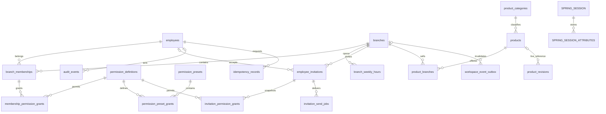

# 기반 기능 DB 설계

작성일: 2026-10-23. 갱신일: 2026-10-24. MySQL 8.4/InnoDB, 기존 V1 확장 설계. 실행 정본은 Flyway V2/V3이며 [전체 구축 SQL·ERD](../../db/README.md)와 [기존 DB 적용 절차](../../db/foundation-upgrade.md)를 제공한다. 사용자가 확정한 [Q1~Q12 정책](decisions.md)을 반영했다.

## 저장 규칙

- PK·FK: `BIGINT UNSIGNED`. API에서는 10진 문자열. 업무 PK와 지점 code는 생성 후 바꾸지 않는다.
- 시각: `DATETIME(6)` UTC, 서버 Clock으로 설정. 영업 요일·분·발급일 계산은 Asia/Seoul. 일자 구간은 후속 발급 설계에서 `[start,end)`로 정한다(Q2).
- 원화·제공량: 양의 정수, DB BIGINT/INT UNSIGNED. API 숫자는 `9007199254740991` 이하로 제한하고 서버에서는 정수 연산한다. nullable 제공량은 0과 구별한다.
- `version`: DB 0부터, API 1부터. 업데이트는 `WHERE id=? AND version=?` 및 `version=version+1`. 부모 집합 수정은 부모 version을 한 번 증가시킨다. 입력 version이 없으면 422, 불일치는 409.
- 문자열: 기본 utf8mb4. 로그인·초대 이메일은 trim·소문자 정규화 후 저장하고 불변으로 관리한다. 이 방식은 기존 DB의 대소문자 무시 유일성과 맞추기 위한 설계 선택이다. 이름은 유일하지 않다.
- 이메일 ID에는 accent-insensitive 비교로 서로 다른 주소가 합쳐지지 않도록 정규화 후 `utf8mb4_0900_as_ci`를 적용한다. 변경 전 기존 중복·길이·정규화 충돌을 점검한다.
- `password_hash`, token/hash, 세션 바이트는 DTO·상품 revision·감사 JSON·멱등 결과·이벤트에 포함하지 않는다.
- 지점·직원 등 핵심 업무 데이터는 비활성화·소속 회수로 종료한다. 상품은 Q8에 따라 구매·결제·발급 이력이 없을 때만 물리 삭제 API를 제공하고, 거래 이력이 있으면 판매 중지한다. 기존 결제·발급·예약·사용 이력 FK의 `RESTRICT`를 유지한다.

## ERD



관리자 가드와 세션 principal은 논리 연결로 관리한다. Spring Session의 PRINCIPAL_NAME은 직원 ID 문자열이며 직원 FK를 임의로 추가하지 않는다. 여러 모듈을 거치는 변경은 공개 서비스 DTO로 조율하고 다른 모듈 Repository/Entity를 직접 사용하지 않는다.

## 데이터 사전

표에서 `!`는 NOT NULL, `?`는 nullable, PK·FK·UQ는 제약이다. `추적 필드`는 `created_at DATETIME(6)!`, `updated_at DATETIME(6)!`, `created_by BIGINT? FK employees RESTRICT`, `updated_by BIGINT? FK employees RESTRICT`, `version BIGINT UNSIGNED! DEFAULT 0`다. 시스템 초기화·기존 데이터 backfill은 작업자를 NULL로 두고 감사에 시스템 작업 사유를 기록한다. 클라이언트가 추적 필드를 지정하면 거절한다.

### branches — 지점 원본(기존 확장)

| 컬럼 | 타입·제약 | 의미 |
| --- | --- | --- |
| id | BIGINT UNSIGNED! PK AUTO_INCREMENT | 불변 지점 ID |
| code | VARCHAR(32)! UQ | 서버 생성 불변 코드 |
| name | VARCHAR(120)! | 지점명 |
| address | VARCHAR(300)! | 주소 |
| phone | VARCHAR(30)? | 연락처 |
| status | ENUM ACTIVE,SUSPENDED! | 운영 중/운영 중지 |
| 추적 필드 | 위 정의 | 지점+주간 영업시간의 집합 버전 |

인덱스: `UNIQUE(code)`, 목록용 `(status,id)`. 지점명 변경에 PK를 재발급하지 않는다. 운영 중지해도 허용 사용자는 이력과 설정을 조회할 수 있다. 신규 판매·배정·예약은 후속 모듈이 같은 branch 정책 서비스로 거부하고 종료·정산을 막지 않는다.

### branch_weekly_hours — 주간 운영시간(기존)

`id BIGINT! PK`, `branch_id BIGINT! FK branches RESTRICT`, `weekday TINYINT!`(월=1~일=7), `is_closed BOOLEAN!`, `opens_minute SMALLINT?`, `closes_minute SMALLINT?`.

`UNIQUE(branch_id,weekday)`. 7개 요일을 API 집합으로 모두 저장한다. 휴무면 분 필드는 NULL. 영업이면 `0<=opens_minute<1440`, `opens_minute<closes_minute<=2880`. 24시간은 0~1440, 익일 02시 종료는 1560 등으로 표현한다. 영업시간 변경은 branches version을 검사·증가시킨다. 상품·예약의 시간 정책과 자동으로 동일시하지 않는다.

### employees — 계정 공통 정보(기존 확장)

| 컬럼 | 타입·제약 | 의미 |
| --- | --- | --- |
| id | BIGINT! PK AUTO_INCREMENT | 직원 ID |
| email | VARCHAR(254)! UQ, 정규화 이메일 collation | 불변 로그인 ID |
| password_hash | VARCHAR(255)! | BCrypt 해시. 신규 비밀번호 정책은 API 참조 |
| name, nickname | 각각 VARCHAR(100)! | 직원명·표시명 |
| avatar_url | VARCHAR(500)? | 기존 프로필 참조, 파일 업로드 구현은 후속 |
| global_role | ENUM OWNER,EMPLOYEE! | 전역 소유권. HTTP 입력 불가 |
| owner_slot | TINYINT generated stored | OWNER이면 1, 그 외 NULL |
| status | ENUM PENDING,ACTIVE,SUSPENDED,LEFT! | 승인 대기·활성·이용 제한·비활성 |
| theme | ENUM FOREST,NAVY,SAND! | 기존 값 유지, 이번 설정 API 범위 밖 |
| last_login_at | DATETIME(6)? | 로그인 기록 |
| 추적 필드 | 공통 정의 | 프로필과 관리자 공통 수정이 같은 version 사용 |

`UNIQUE(owner_slot)`으로 사장님은 최대 1명이다. 최소 한 명 활성 상태인지는 관리자 가드 트랜잭션으로 지킨다. `(status,id)` 인덱스. 확정 정책 Q3에 따라 공통 이름·상태 변경은 OWNER만 가능하다. 전역 상태를 소속 상태로 대체하지 않는다. 승인으로 PENDING을 ACTIVE로 바꿀 수 있으나 SUSPENDED/LEFT를 초대 승인으로 되살리지 않는다.

### branch_memberships — 지점별 역할·상태(기존 확장)

`id BIGINT! PK`, `employee_id BIGINT! FK employees RESTRICT`, `branch_id BIGINT! FK branches RESTRICT`, `role ENUM MANAGER,STAFF!`, `status ENUM PENDING,ACTIVE,REVOKED!`, `approved_by BIGINT? FK employees RESTRICT`, `approved_at DATETIME(6)?`, 추적 필드.

`UNIQUE(employee_id,branch_id)` 유지. 역방향 기존 UNIQUE도 유지 가능하며 정리 여부는 실행계획 확인 후 별도 결정한다. 목록 인덱스 `(branch_id,status,role,id)`. `status=ACTIVE` 승인 흐름은 approved_by/at를 함께 기록한다. 기존 활성 소속의 NULL 승인 기록은 과거 데이터를 임의로 채우지 않는다. 회수된 행은 보존·재사용하며 재초대 승인 시 같은 행의 version을 증가시킨다.

지점별 권한 변경은 membership version과 직원 aggregate version을 모두 확인·증가시킨다. 직원 version 공유는 기존 NEXT-02의 충돌 조건을 유지한다. 서로 다른 지점의 동시 편집도 409가 날 수 있으므로 재조회 후 명시적으로 다시 저장한다. 타 지점 소속을 누락했다고 삭제하지 않는다.

### permission_definitions / permission_presets / grants — 권한(기존 확장)

- `permission_definitions`: `id BIGINT! PK`, `code VARCHAR(80)! UQ`, `description VARCHAR(255)!`, `is_admin_only BOOLEAN!`. 코드 사전은 버전 관리 seed로 제공하고 임의 코드 입력을 422로 거절한다.
- 1차 코드: `members:write`, `operations:write`, `payments:read`, `payments:write`, `sales:read`, `facilities:write`, `notices:write`, `people:manage`, `ai:read`. 후속 업무의 권한 정의를 미리 저장하되 해당 API 구현을 뜻하지 않는다.
- `permission_presets`: `id BIGINT! PK`, `name VARCHAR(100)!`, `role ENUM MANAGER,STAFF!`, `is_system BOOLEAN!`, 추적 필드. `UNIQUE(name,role)` 유지. 기본값 변경은 seed migration, 사용자 정의 생성·수정은 OWNER만 가능하다. 시스템 프리셋은 일반 HTTP로 수정하지 않는다.
- `permission_preset_grants`: PK `(preset_id,permission_id)`, FK preset CASCADE, permission RESTRICT. 부모 version으로 집합 수정.
- `membership_permission_grants`: PK `(membership_id,permission_id)`, FK membership CASCADE, permission RESTRICT. 프리셋을 복사한 최종 실효 권한이다. 프리셋 원본 수정은 이 행들을 바꾸지 않는다.
- `people:manage`를 보유한 STAFF도 관리자 전용 초대·승인·권한 변경을 수행할 수 없다. **역할 MANAGER와 행위 권한을 함께 검사**한다. OWNER는 전역 접근을 갖는다. 코드 사전의 is_admin_only 및 역할 제한을 서버에서 검증한다.

초기 기본 프리셋(Q5): `일반 직원 기본`은 role=STAFF·grants 빈 집합, `지점 관리자 기본`은 role=MANAGER·위 9개 코드 전부다. 두 프리셋 모두 is_system=true이며 ID는 seed 실행 시 생성한다. 적용할 때 복사하고 기존 직원에 자동 소급하지 않는다.

권한 위임(Q4)은 현재·요청 역할을 모두 검사한다. 지점 관리자는 본인 이외 EMPLOYEE의 대상 지점 STAFF만 관리하고 MANAGER 임명·권한 변경·승인은 OWNER만 처리한다. 현재 MANAGER를 STAFF로 낮춰 권한을 바꾸는 우회나 자기 권한 변경도 거부한다. 같은 employee·membership 잠금에서 현재 역할과 인가를 확인한다. Q6에 따라 STAFF라도 operations:write를 명시적으로 부여받으면 상품 등록·가격·구성 수정은 가능하다.

### employee_invitations — 초대와 승인(기존 확장)

| 컬럼 | 타입·제약 | 의미 |
| --- | --- | --- |
| id | BIGINT! PK | 초대 ID |
| branch_id | BIGINT! FK branches RESTRICT | 대상 지점 |
| invitee_name | VARCHAR(100)! **추가** | 초대 시 입력 이름 |
| invitee_email | VARCHAR(254)! | 고정 초대 이메일, 계정과 같은 정규화 |
| initial_role | ENUM MANAGER,STAFF! | 승인 예정 역할 |
| preset_id | BIGINT? FK permission_presets SET NULL | 선택 이력. 권한 원본으로 재참조하지 않음 |
| created_by | BIGINT! FK employees RESTRICT | 발송 요청자(기존 컬럼) |
| accepted_employee_id | BIGINT? FK employees RESTRICT | 수락한 본인 계정 |
| approved_by, approved_at | BIGINT? FK / DATETIME(6)? | 최종 승인자·시각 |
| rejected_by, rejected_at | BIGINT? FK / DATETIME(6)? **추가** | 반려자·시각 |
| rejection_reason | VARCHAR(500)? **추가** | 반려 시 필수 사유 |
| cancelled_by, cancelled_at | BIGINT? FK / DATETIME(6)? **추가** | 수락 전 취소 |
| status | ENUM PENDING,ACCEPTED,APPROVED,REJECTED,CANCELLED,EXPIRED! | 초대 상태 |
| active_invitation_slot | TINYINT generated stored | PENDING/ACCEPTED이면 1, 그 외 NULL |
| token_hash | BINARY(32)? | SHA-256 검증 해시. 원문 토큰은 저장 금지 |
| revision | INT UNSIGNED! | 발송 시도·재발급의 단조 증가값 |
| expires_at | DATETIME(6)! | 링크 만료. ACCEPTED 이후 승인 기한이 아님 |
| accepted_at | DATETIME(6)? | 수락 시각 |
| created_at, updated_at | DATETIME(6)! | 기존 시각 |
| updated_by | BIGINT? FK employees RESTRICT **추가** | 최종 작업자 |
| version | BIGINT UNSIGNED! | aggregate version |

제약·인덱스:

- `UNIQUE(branch_id,invitee_email,active_invitation_slot)` 유지. 만료 대기 행을 신규 발급 트랜잭션에서 잠금·EXPIRED 전환한 뒤 새 초대를 만든다. 스케줄러 지연만으로 신규 초대를 영원히 막지 않는다.
- `UNIQUE(token_hash)` 추가(여러 NULL 허용). 조회는 토큰 원문 SHA-256 후 해시 인덱스로 처리한다. 토큰 원문·revision은 관리자 목록에 공개하지 않는다.
- `(branch_id,status,id)`, `(invitee_email,status)`, `(status,expires_at)`.
- `REJECTED`이면 rejected_by/at/reason 필수, `CANCELLED`이면 cancelled_by/at 필수, 수락 후에는 token_hash=NULL. 상태와 nullable 필드의 CHECK는 기존 데이터 점검·backfill 후 활성화한다.
- Q12에 따라 `ACCEPTED`는 별도 승인 기한이 없고 링크 TTL이 지나도 자동 EXPIRED가 되지 않는다. 승인·반려만 가능하다. 미수락 PENDING/EXPIRED는 같은 이메일·지점의 다른 진행 초대가 없을 때 수동 재발급할 수 있다. 수동 재발급은 새24시간 TTL, 자동 재시도는 기존 expires_at 유지이며 감사에 구분해 남긴다.

### invitation_permission_grants — 초대 예정 권한(신규)

`invitation_id BIGINT! FK employee_invitations RESTRICT`, `permission_id BIGINT! FK permission_definitions RESTRICT`, 복합 PK. 초대 생성 당시 선택한 프리셋 권한을 복사한다. 수락·승인 사이 원본 프리셋 변경으로 승인 범위가 달라지지 않는다. 승인 시 현재 관리자·역할 정책으로 재검증하고 최종 소속 grants로 복사한다. 승인이 끝나도 예정 권한 기록은 남긴다.

### invitation_send_jobs — 메일 작업(기존 확장)

기존 `id BIGINT! PK`, `invitation_id BIGINT! FK RESTRICT`, `revision INT!`, `status ENUM PENDING,PROCESSING,SENT,FAILED,SKIPPED!`, `attempts INT!`, `next_attempt_at DATETIME?`, `sent_at DATETIME?`, `last_error_code VARCHAR(80)?`, `created_at/updated_at DATETIME!`를 유지한다.

`locked_until DATETIME(6)?`, `worker_id VARCHAR(100)?`를 추가해 프로세스 장애 후 lease를 회수한다. `UNIQUE(invitation_id,revision)`, 작업 탐색 인덱스 `(status,next_attempt_at,id)`, `(status,locked_until,id)`.

생성·재발급·자동 재시도 예약은 invitation 잠금 후 현재 상태·TTL을 확인하고 **새 revision을 예약·기존 해시 NULL 처리·같은 revision의 PENDING job 생성**을 한 번에 한다. 최초 생성은 revision=1/job=1이다. worker는 현재 revision과 일치하는 PENDING job을 claim하고, 같은 트랜잭션에서 새 토큰·해시를 생성하며 job을 PROCESSING/lease 상태로 바꾼다. 하나의 revision에서 토큰을 다시 생성하지 않는다. 원문은 메모리에만 두고 커밋 뒤 메일을 전송한다.

성공 기록도 invitation의 현재 revision과 job lease를 확인한다. 실패·lease 만료는 이전 job의 재예약 시각을 비우고 새 revision/job을 예약한다. PROCESSING의 토큰 원문을 잃은 worker는 기존 해시로 링크를 복원하지 않는다. 수동 재발급·자동 재시도가 경합해도 invitation 잠금과 job UNIQUE로 한 개의 최신 revision만 유효하다. 자동 예약은 기존 expires_at을 유지한다. 늦게 끝난 이전 worker가 현재 발송 상태를 덮어쓰지 못하고, 오래된 미발송 job은 SKIPPED 처리한다. 외부 메일 호출 동안 DB 잠금을 잡지 않는다. revision·해시 변경은 invitation version도 증가시키며 관리 화면은 충돌 시 재조회한다.

### product_categories — 상품 통계 분류(신규)

`id BIGINT! PK`, `code VARCHAR(40)! UQ`(불변), `name VARCHAR(100)!`, `kind ENUM TIME,PERIOD,STORED_VALUE!`, `status ENUM ACTIVE,INACTIVE!`, 추적 필드. `(kind,status,id)` 인덱스. 분류 중지 시 신규 선택은 금지하지만 기존 상품·revision의 연결은 유지한다. 같은 kind만 상품에 연결한다(서비스 검증). 분류 변경 권한은 OWNER로 제한하는 설계 선택이다.

### products — 상품 현재 조건(기존 확장)

| 컬럼 | 타입·제약 | 의미 |
| --- | --- | --- |
| id, code | BIGINT! PK / VARCHAR(40)! UQ | 기존 불변 ID·서버 생성 코드 |
| name | VARCHAR(120)! | 상품명 |
| kind | ENUM TIME,PERIOD,STORED_VALUE! | 시간권·기간권·정액권 |
| price_krw | BIGINT UNSIGNED! CHECK >0 | 판매가 |
| included_minutes | INT UNSIGNED? | TIME만 양수 분 |
| period_days | INT UNSIGNED? | PERIOD만 양수 일수(Q2) |
| credit_krw | BIGINT UNSIGNED? | STORED_VALUE만 양수 충전 원화 |
| hourly_rate_krw | BIGINT UNSIGNED? | STORED_VALUE만 양수 시간당 원화 |
| valid_days | INT UNSIGNED? | TIME/STORED_VALUE 선택 유효 일수, NULL 무기한 |
| category_id | BIGINT! FK product_categories RESTRICT **추가** | 통계 분류 |
| sale_status | ENUM ON_SALE,STOPPED! | 신규 판매 가능 상태 |
| 추적 필드 | 공통 정의 | 조건·적용 지점 전체의 version |

유형별 CHECK(서비스 입력 검증도 병행):

```sql
CHECK (price_krw > 0);
CHECK (
 (kind='TIME' AND included_minutes>0 AND included_minutes IS NOT NULL
  AND period_days IS NULL AND credit_krw IS NULL AND hourly_rate_krw IS NULL)
 OR (kind='PERIOD' AND period_days>0 AND period_days IS NOT NULL
  AND included_minutes IS NULL AND credit_krw IS NULL AND hourly_rate_krw IS NULL
  AND valid_days IS NULL)
 OR (kind='STORED_VALUE' AND credit_krw>0 AND credit_krw IS NOT NULL
  AND hourly_rate_krw>0 AND hourly_rate_krw IS NOT NULL
  AND included_minutes IS NULL AND period_days IS NULL)
);
CHECK (valid_days IS NULL OR valid_days>0);
```

SQL CHECK의 UNKNOWN 통과를 막기 위해 필수 nullable 수치에는 IS NOT NULL을 명시한다. API의 제공량·원화 상한은 서비스에서 검사한다. `kind` 변경은 기존 구매를 소급 변경하지 않지만 이번 API에서는 등록 후 유형 변경을 거부한다. 다른 유형은 새 상품으로 등록하는 설계 선택이다. 명칭·가격·제공량·분류·판매 범위 변경은 새 revision을 만든다. `(kind,sale_status,id)`, `(category_id,id)` 인덱스.

### product_branches — 판매 지점(신규)

`product_id BIGINT! FK products RESTRICT`, `branch_id BIGINT! FK branches RESTRICT`, PK `(product_id,branch_id)`, 역방향 인덱스 `(branch_id,product_id)`. 최소 1개는 서비스 트랜잭션에서 검사한다. `all` 문자열이나 ‘미래 생성 지점 자동 포함’ 플래그를 저장하지 않고 구체적 지점 집합만 저장한다. 수정 시 현재와 변경 후 집합 전부에 대해 권한을 확인한다. 과거 적용 지점은 revision snapshot에 보존한다.

### product_revisions — 상품 변경·삭제 및 구매 참조 조건(신규)

`id BIGINT! PK`, `product_id BIGINT? FK products SET NULL`(생존 상품 연결), `original_product_id BIGINT!`(원래 상품 ID, 불변·FK 없음), `product_version BIGINT UNSIGNED!`(DB version), `event_type ENUM CREATED,UPDATED,DELETED,BASELINE!`, `changed_by BIGINT? FK employees RESTRICT`, `changed_at DATETIME(6)!`, `request_id VARCHAR(128)!`, `reason VARCHAR(500)?`, `snapshot_json JSON!`.

`UNIQUE(original_product_id,product_version)`, `(original_product_id,changed_at,id)`. snapshot schema version을 `snapshot_json.schemaVersion=1`로 저장하고 code/name/kind/priceKrw/유형별 제공량/validDays/분류 code·name/판매 상태/구체적 branchIds를 함께 저장한다. 이전 revision과 비교해 변경 전후를 구성한다. 초기 생성도 revision 0을 기록하고 migration의 현재 조건 기록은 BASELINE으로 구분한다. 이력 내용은 UPDATE하지 않는다. 상품 삭제 시 FK가 product_id를 NULL로 바꾸더라도 original_product_id·조건·작업자·시각은 그대로 남는다.

Q8 삭제 트랜잭션은 상품과 관련 지점을 잠근 뒤 현재 인가·version 및 payments/passes 등 모든 거래 참조 부재를 검사한다. 실패·환불 결제도 참조 이력으로 취급한다. 마지막 조건의 다음 version에 DELETED revision·감사·지점별 무효화 알림을 기록하고 product_branches를 제거한 뒤 products를 삭제한다. 구매·발급 쓰기도 같은 상품 잠금과 FK를 사용해 검사/삭제 사이 거래 생성 경합을 막는다. 참조가 발견되거나 FK가 충돌하면409로 전체 롤백한다. DB 제약을 꺼서 삭제하지 않는다.

DELETED revision의 snapshot_json은 삭제 직전 조건이다. API에서는 before=해당 조건, after=null, changeType=DELETED로 표현한다. 삭제 후 일반 상품 상세는404이며 history는 original_product_id로 조회한다. history 인가는 보존된 현재/과거 snapshot의 모든 지점 범위로 판단해 삭제로 권한 검사를 우회하지 않는다. 거래 이력이 있는 상품은 이 삭제 경로에 들어갈 수 없다.

분류 이름·활성 상태 등 외부 분류 원본 변경도 해당 상품의 통계 분류 의미를 바꾸지 않아야 한다. 분류 code는 불변이고, 상품 revision에는 이름까지 저장한다. 후속 구매·발급은 거래 당시 revision ID와 조건 스냅샷을 함께 기록하는 계약이다. 기존 passes/payments를 이번 단계에서 바꾸거나 기존 거래에 새 revision을 임의 연결하지 않는다.

### audit_events — 권한 및 변경 감사(기존 확장)

기존 `id`, `actor_employee_id?`, `branch_id?`, `entity_type VARCHAR(80)!`, `entity_id BIGINT!`, `action VARCHAR(80)!`, `reason VARCHAR(500)?`, `before_json JSON?`, `after_json JSON?`, `occurred_at DATETIME!`에 다음을 추가한다.

- `request_id VARCHAR(128)?`(기존 행은 NULL, 신규 필수 서비스 검증), `(request_id)` 인덱스.
- `result ENUM SUCCESS,DENIED,FAILED! DEFAULT SUCCESS`.
- `entity_id`는 로그인 실패처럼 대상이 없을 수 있어 nullable로 확장한다. 기존 행은 유지한다.
- `before_json/after_json`은 소속 역할·상태·최종 권한 code 집합 등 허용 필드만 저장한다. 계정은 ID만, 비밀번호·토큰·세션·메일 링크·요청 전체는 저장하지 않는다.

성공한 업무 변경 감사는 같은 트랜잭션. 거절·인증 실패는 주 트랜잭션 롤백과 구별해 안전한 진단 경로로 기록한다. 보존 기간은 운영 설정 및 별도 개인정보 정책 확정 대상이다. 상품 이력을 일반 감사 정리 작업으로 삭제하지 않는다.

### administration_guard — 관리자 0명 방지(신규)

`id TINYINT UNSIGNED! PK CHECK(id=1)`, `updated_at DATETIME(6)!`. migration으로 단일 행 생성. 최초 OWNER 생성, OWNER 상태 변경, 관리 역할·권한 회수 시 이 행부터 `SELECT ... FOR UPDATE` 한다. 유효 관리자 집합은 활성 OWNER 또는 대상 지점의 활성 MANAGER+people:manage다. OWNER는 모든 지점의 유효 관리자로 계산한다. 다른 지점 역할을 OWNER로 바꿀 수 없다. OWNER가 유일한 전역 관리자일 때 비활성화·제한 요청은 409 LAST_ADMIN_REQUIRED.

### idempotency_records — 재전송 제어(신규)

`id BIGINT! PK`, `actor_employee_id BIGINT! FK employees RESTRICT`, `operation VARCHAR(120)!`, `scope_key VARCHAR(160)!`, `idempotency_key VARCHAR(128)!`(binary collation), `request_hash BINARY(32)!`, `state ENUM PROCESSING,COMPLETED!`, `http_status SMALLINT?`, `response_json JSON?`, `created_at DATETIME!`, `expires_at DATETIME!`.

`UNIQUE(actor_employee_id,operation,scope_key,idempotency_key)`, `(expires_at,id)`. scope_key는 `branch:ID`, `branches:정렬한집합해시`, `global` 중 하나이며 클라이언트 임의 문자열을 신뢰하지 않는다. 정규화한 명령의 의미 필드로 해시를 계산한다. CSRF·requestId는 해시 대상이 아니다.

새 업무 변경과 멱등 성공 결과는 하나의 트랜잭션으로 커밋한다. 처리 중 중복은 UNIQUE 잠금 대기 후 완료 결과를 읽거나 409 REQUEST_IN_PROGRESS+Retry-After. 롤백된 업무는 멱등 결과도 롤백한다. 재시도 시 현재 인증·인가를 먼저 검사한다. 멱등 키 유효기간 기본 24시간은 기술 제안이며 응답 설명과 청소 작업을 일치시킨다. 비밀번호·초대 토큰을 포함하는 accept/login에는 이 테이블을 사용하지 않는다. 승인 등은 상태 전이·DB 제약으로 중복 활성화를 막는다.

### workspace_event_outbox — 커밋 후 갱신 알림(신규)

`id BIGINT! PK`(전역 전달 순서의 논리 힌트), `branch_id BIGINT? FK branches RESTRICT`, `target_employee_id BIGINT? FK employees RESTRICT`, `entity_type VARCHAR(80)!`, `entity_id BIGINT?`, `event_type ENUM INVALIDATE,AUTHORIZATION_CHANGED!`, `occurred_at DATETIME!`, `published_at DATETIME?`, `attempts INT! DEFAULT 0`, `next_attempt_at DATETIME?`, `locked_until DATETIME?`, `worker_id VARCHAR(100)?`.

`(published_at,next_attempt_at,id)`, `(target_employee_id,id)`. 업무 트랜잭션에 알림을 적재하고 커밋 후 전송한다. 권한 변경 이벤트는 대상 직원에게 scope 정보 없이 보낸다. 여러 지점의 상품 변경은 각 지점 이벤트로 분해하고 타 지점 ID 집합을 payload로 보내지 않는다. 한 인스턴스의 published 표시는 다른 인스턴스에 연결된 수신자의 전달 완료를 뜻하지 않는다. 다중 ECS task 운용 전 fan-out 전송 수단 또는 인스턴스별 cursor를 선택·검증해야 한다. 1차 구현은 단일 인스턴스 dispatch+주기적 상태 재검증을 대상으로 한다.

### SPRING_SESSION / SPRING_SESSION_ATTRIBUTES — 세션(기존 유지)

기존 표준 컬럼·PK·만료 인덱스를 그대로 사용한다. attributes에 인증 시각, 유효 활동 시각, sessionMode(WORKSPACE/APPROVAL_ONLY), principal의 직원 ID만 보관한다. 권한 snapshot을 인가 원본으로 사용하지 않는다. 확정 정책 Q1에 따라 신규 PENDING 직원은 승인 조회용 제한 세션을 사용한다. 기존 ACTIVE 직원의 추가 소속 승인 대기로 기존 유효 지점 세션 권한을 막지 않는다. 미사용 만료는 프레임워크 저장소와 서버의 유효 활동 시각 검증을 함께 사용하고 SSE heartbeat·자동 polling만으로 연장하지 않는다.

## 트랜잭션과 잠금 순서

| 명령 | 원자적 변경과 경합 처리 |
| --- | --- |
| 지점 등록·수정 | 멱등 등록 또는 branch version 검사 → branches+7요일 → 감사+이벤트. 운영 상태는 같은 branch 잠금을 쓰는 신규 운영 명령과 직렬화한다. |
| 소속·권한 변경 | 가드 → 대상 직원 → 대상 지점 → membership 순서 잠금. 현재 권한 재확인 → 직원·소속 version 검사 → 역할·grants → 양쪽 version 증가 → 감사+직원 권한 이벤트. |
| 계정 상태 변경 | 가드 → 직원 → 소속 지점 ID 오름차순 잠금. 유효 관리자 보호 → 직원 version 변경 → 감사+권한 회수 이벤트. 커밋 후 세션·SSE 폐기. 새 요청은 DB 상태 검사로 먼저 거부된다. |
| 초대 생성 | branch 잠금 → 같은 이메일/지점의 진행 초대 점검 → 초대+예정 권한+send job → 감사. 직원 신규 생성은 하지 않는다. |
| 초대 수락 | 토큰 해시로 후보 찾기 → 직원(기존일 경우) → branch → invitation 잠금 및 토큰/TTL/revision 재검증 → 신규 PENDING 계정 또는 본인 인증 확인 → PENDING 소속 → ACCEPTED·해시 폐기 → 감사. 동시 신규 이메일 생성은 UNIQUE로 1회만. 충돌은 재조회 후 안전한 409. |
| 최종 승인 | 가드 → 직원 → branch → invitation → membership 잠금. ACCEPTED·계정 상태·소속 중복·관리 권한 재검증 → PENDING 계정만 ACTIVE, membership ACTIVE+예정 grants → APPROVED·승인자 → 감사+권한 이벤트. 반복 요청은 이미 승인된 결과 반환, 반려/취소와의 충돌은 409. |
| 재발급·취소·반려 | 현재 상태·version 조건부 수정과 토큰 폐기·작업 무효화·감사. 반려는 PENDING 소속만 REVOKED로, 다른 소속·ACTIVE 계정은 그대로 유지(Q1). |
| 상품 변경 | 현재·새 지점 ID 오름차순 잠금 → product 잠금 → 버전·모든 지점 권한 검증 → 조건·적용 지점 → 새 revision → 감사+지점별 이벤트. 기존 결제·passes는 수정하지 않는다. |
| 미거래 상품 삭제 | 관련 지점 → product 잠금 → 현재 인가·version·모든 거래 참조0건 확인 → DELETED revision+감사+이벤트 → 판매 지점 연결 제거 → 상품 물리 삭제. 이력은 원래 ID로 보존, 모든 변경 함께 커밋. |

공통 잠금 순서는 **관리자 가드(필요할 때) → actor 및 대상 employees ID 오름차순 → branches ID 오름차순 → invitation/product 등 업무 부모 → 소속·grants 등 자식**이다. 표의 각 업무 잠금 앞에 쓰기 actor의 현재 계정·권한 확인용 employee 잠금을 적용한다. branch/product 잠금 뒤에 employee 잠금을 추가해 역순을 만들지 않는다. 초대 worker는 invitation만 잠그고 직원/branch를 나중에 잠그지 않는다. 데드락 시 트랜잭션 전체를 제한 횟수 재시도하되 권한·상태·version을 다시 검사한다. 외부 SMTP·SSE 네트워크 호출은 DB 트랜잭션 밖이다. 권한 회수와 쓰기의 경합은 같은 권한 aggregate 잠금으로 직렬화하고, 회수 커밋 이후 인가를 받는 요청에는 새 권한을 적용한다.

## V1 확장 순서

기존 V1 checksum을 유지한다. V2는 확장·검토 표식, V3는 사전 검사·강화·seed·BASELINE 생성을 담당한다. 기존 상품·초대가 있으면 target=2에서 명시 매핑을 확인한 뒤 V3로 진행한다. 아래는 실제 적용 단계다.

1. **사전 조회**: 정상·미정규화 이메일, 충돌, 가격 0/범위 초과, 초대 상태별 누락 값, 기간권 valid_days, 기존 상품의 적용 지점 근거를 조사한다. 데이터가 애매하면 migration을 실패시키고 명시 매핑을 요청한다.
2. **확장**: 신규 테이블·nullable 추적/초대/분류 필드를 먼저 추가한다. 신규 제약을 만족하지 않는 기존 행을 숨기지 않는다.
3. **backfill**: 기존 직원·지점 ID·version 유지. 과거 초대 이름은 accepted employee의 검증 가능한 이름을 우선 사용하고 수락 전 이름은 운영자 매핑을 받는다. 사유·작업자·과거 변경 시각을 꾸며내지 않는다. 기존 상품의 category·판매 지점은 명시 매핑으로 채운다. 모든 지점에 자동 공개하지 않는다.
4. **최초 revision**: 현재 확인 가능한 상품 조건만 migration 시점 revision으로 기록한다. 실제 과거 가격 이력이 존재했다고 표시하지 않는다. 기존 구매 snapshot은 그대로 보존한다.
5. **강화**: NULL·중복·제약 위반 0건 확인 후 NOT NULL, CHECK, FK, hash UNIQUE와 이메일 collation 변경. 변경 전후 행 수·PK/FK·금액·version을 비교한다.
6. **코드 전환**: 운영 쓰기 API·DTO와 새 스키마를 함께 배포하고 하위 호환 필드 종료 순서를 정한다. 개발과 운영의 `ddl-auto=validate` 유지.

운영 적용 전 백업·매핑 검토와 환경별 권한 검증을 마친다. 알 수 없는 적용 지점을 임의 생성하는 자동 backfill은 금지한다. 테스트 데이터는 Testcontainers seed로 별도 만든다. 아래 인수 항목 중 이번에 수행한 DB 검증은 [보고서](../../verification/foundation-schema-v3.md)에 구분했으며 서비스 경합·세션 정책 보완은 후속 구현 항목이다.

## 구현 시 DB 인수 검증

- 빈 DB V1+후속 migration, V1 데이터가 있는 DB 업그레이드 모두 성공. 기존 SQL checksum 유지·복원 검증.
- 잘못된 상품 조합·0원·중복 이메일·중복 진행 초대·중복 OWNER를 직접 SQL에서도 거부.
- 다른 두 연결로 마지막 관리자 동시 회수, 초대 승인/반려, 이중 수락, 재발급/worker, 동일 멱등 키 등록을 실행해 부분 성공·중복 생성 없음.
- 기존 결제·이용권이 참조하는 상품·직원·지점 FK 보존. 가격 변경 뒤 기존 구매 금액·조건 변화 없음.
- transaction rollback 시 감사 성공 이벤트·revision·멱등 성공 결과·발송 작업이 남지 않음.
- JDBC 세션 재기동·회수·유효 활동 만료, 권한 회수 후 SSE 전달 차단. 이 항목들은 **이번 문서 작성에서 실행한 테스트가 아니다**.
