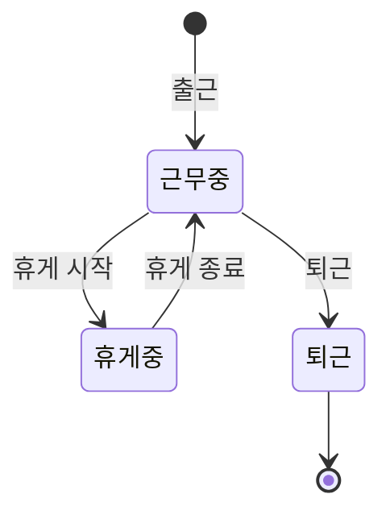

# 근무표·근태 API 계약

Backend [#82](https://github.com/OpenStudyService/OpenStudy-Backend/issues/82)의 M8 계약이다. 구현은 근무표(#83)와 출퇴근·근태 조회(#84)에서 이 문서를 기준으로 진행한다. Frontend는 같은 [OpenAPI](openapi.json)(`0.1.10-m8-workforce`)로 연동한다.

정책 근거는 [ADR-M8-001](../../db/ADR-M8-001.md)(M8-D01~D08)이다. 공통 요청·응답·오류·목록 규칙은 [API 계약](api.md)을 따른다. 휴가·대체근무·근태 정정은 [ADR-M12-001](../../db/ADR-M12-001.md)의 M12 범위다.

2026-11-03: 이 문서의 operation은 모두 설계 계약(`design-target`)으로 정했다. 2026-11-03: 근무표 operation 6개(주간 근무표·목록·등록·상세·수정·취소)는 #83에서 구현됐다(`implemented`). 2026-11-03: 근태 operation 7개(현재 근태·출근·휴게 시작·휴게 종료·퇴근·근태 목록·근태 상세)는 #84에서 구현됐다(`implemented`). 이로써 이 문서의 M8 operation 13개가 모두 구현됐다. 스키마는 바꾸지 않는다. V1의 `shifts`, `shift_events`, `attendance_records`, `attendance_breaks`, `leave_requests`를 그대로 쓴다.

## 제공 범위

### 근무표

| API | 권한 | 동작 | 구현 |
| --- | --- | --- | --- |
| `GET /shifts/weekly` | scope 지점의 유효 소속. 행은 [조회 범위](#권한과-조회-범위m8-d01d02) | 주간 근무표. 예정 근무와 실제 출퇴근을 따로 반환 | #83 |
| `GET /shifts` | scope 지점의 유효 소속. 행은 조회 범위 | 근무 목록 | #83 |
| `POST /shifts` | `branchId` 지점의 MANAGER 이상(M8-D01) | 예정 근무 등록. `Idempotency-Key` 필수 | #83 |
| `GET /shifts/{id}` | 근무를 볼 수 있는 사용자 | 근무 상세와 연결된 근태 | #83 |
| `PATCH /shifts/{id}` | 근무 지점의 MANAGER 이상 | 시작·종료·예정 휴게 수정 | #83 |
| `POST /shifts/{id}/cancel` | 근무 지점의 MANAGER 이상 | 근무 취소 | #83 |

### 근태

| API | 권한 | 동작 | 구현 |
| --- | --- | --- | --- |
| `GET /me/attendance/current` | 본인 | 진행 중인 본인 근태 | #84 |
| `POST /me/attendance/clock-in` | 본인. `branchId` 지점의 활성 소속(M8-D08) | 출근. `Idempotency-Key` 필수 | #84 |
| `POST /me/attendance/break-start` | 본인 | 휴게 시작 | #84 |
| `POST /me/attendance/break-end` | 본인 | 휴게 종료 | #84 |
| `POST /me/attendance/clock-out` | 본인 | 퇴근 | #84 |
| `GET /attendance-records` | scope 지점의 유효 소속. 행은 조회 범위 | 본인·관리자 근태 목록. `mine=true`면 본인 것만 | #84 |
| `GET /attendance-records/{id}` | 근태를 볼 수 있는 사용자 | 근태 상세 | #84 |

## 공통 규칙

- OWNER는 모든 권한 조건을 만족한다. 이 문서의 "MANAGER 이상"은 OWNER이거나 해당 지점의 활성 소속이 `role=MANAGER`인 경우다. M8-D01은 행위 권한을 따로 요구하지 않으므로 지점 MANAGER 조건에 행위 권한(`people:manage` 등)을 더하지 않는다. M7의 MANAGER 판정과 같다.
- **범위**: 볼 수 없는 근무·근태는 목록·total·주간 근무표에 없고 상세는 404다. scope에 없는 지점을 지정하면 403이다.
- **수정 충돌**: 근무 수정·취소와 휴게·퇴근은 조회한 `version`을 받는다. 다르면 409 `VERSION_CONFLICT`이고 `latestVersion`과 `reloadUrl`을 준다. `reloadUrl`은 근무는 `/api/shifts/{id}`, 근태는 `/api/me/attendance/current`다.
- **요청 키**: 근무 등록과 출근만 `Idempotency-Key`가 필수다. [요청 키](#요청-키) 절에 이유가 있다.
- `canEdit` 같은 응답 필드는 화면 안내용이다. 서버는 쓰기마다 다시 검사한다.
- 삭제 API는 없다. 근무는 취소로 닫고 근태는 정정(M12)으로만 바꾼다.
- 변경 알림은 [workspace 이벤트](#workspace-이벤트)를 따른다.

### 추가 오류 코드

| HTTP | code | 의미 |
| --- | --- | --- |
| 422 | `SHIFT_TIME_INVALID` | 종료가 시작보다 늦지 않음, 24시간 초과, 분 단위가 아닌 시각 |
| 422 | `SHIFT_BREAK_INVALID` | 예정 휴게 분이 근무 길이 이상 |
| 422 | `INVALID_SHIFT_EMPLOYEE` | 대상 직원이 근무 지점의 활성 소속 활성 직원이 아님(없는 직원 포함) |
| 409 | `SHIFT_CONFLICT` | 같은 직원의 다른 근무나 승인 휴가와 시간이 겹침. [충돌 응답](#충돌-응답m8-d05d06) |
| 409 | `ATTENDANCE_ALREADY_WORKING` | 진행 중인 본인 근태가 있는데 출근 |
| 409 | `ATTENDANCE_NOT_WORKING` | 진행 중인 본인 근태가 없는데 휴게·퇴근(중복 퇴근 포함) |
| 409 | `ATTENDANCE_ON_BREAK` | 휴게 중에 휴게 시작 또는 퇴근 |
| 409 | `ATTENDANCE_NOT_ON_BREAK` | 휴게 중이 아닌데 휴게 종료 |

기존 코드도 쓴다. 운영 중지 지점은 409 `BRANCH_NOT_ACTIVE`, 취소된 근무의 수정·재취소는 409 `INVALID_STATE`, `branchId`·`employeeId`·`status`를 담은 근무 수정은 422 `IMMUTABLE_FIELD`다.

입력 오류(시간·휴게·대상 직원)는 422, 다른 근무·휴가·근태 상태와의 충돌은 409다. 화면은 입력을 고치도록 안내할지, 다른 시간을 고르거나 최신 상태를 확인하도록 안내할지 이 코드로 구분한다.

## 권한과 조회 범위(M8-D01·D02)

### 쓰기

| 명령 | 권한 | 대상 |
| --- | --- | --- |
| 근무 등록 | `branchId` 지점의 MANAGER 이상 | 대상 직원은 그 지점의 활성 소속이고 계정이 활성이어야 한다 |
| 근무 수정 | 근무 지점의 MANAGER 이상 | 대상 직원이 여전히 그 지점의 활성 소속이어야 한다 |
| 근무 취소 | 근무 지점의 MANAGER 이상 | 대상 직원의 소속 상태와 무관하다(정리 동작) |
| 출근 | 본인 | `branchId` 지점의 활성 소속(M8-D08) |
| 휴게 시작 | 본인 | 진행 중인 본인 근태의 지점이 활성 소속이어야 한다 |
| 휴게 종료·퇴근 | 본인 | 진행 중인 본인 근태. 소속이 회수돼도 허용한다(정리 동작) |

- MANAGER는 다른 MANAGER와 자기 자신의 근무도 등록할 수 있다. M8-D01은 대상 역할을 제한하지 않는다.
- 근무 등록 대상과 출근 지점은 `branch_memberships`를 참조한다(`fk_shifts_1`, `fk_attendance_records_1`). 소속 행이 없는 OWNER는 근무 대상이 될 수 없고(422 `INVALID_SHIFT_EMPLOYEE`) 출근할 수 없다(403). OWNER의 전역 권한은 남의 근무를 관리하는 데만 쓰인다.
- 볼 수 없는 근무의 수정·취소는 404, 볼 수 있지만 그 지점 MANAGER가 아니면(예: 일반 직원의 본인 근무) 403이다.

### 조회 범위

근무와 근태 모두 **기록된 지점**(`shifts.branch_id`, `attendance_records.branch_id`)으로 판정한다.

| 요청자 | 보이는 근무·근태 |
| --- | --- |
| OWNER | 전부 |
| 기록 지점의 MANAGER | 그 지점에 기록된 모든 직원의 근무·근태 |
| 그 외 | 본인 기록 중 기록 지점이 현재 유효 소속인 것 |

- 한 사람이 지점마다 역할이 다르면 지점별로 따로 판정한다. A 지점 MANAGER이고 B 지점 STAFF이면 A는 전 직원, B는 본인 기록만 본다.
- 같은 직원이 다른 지점에서 일한 기록은 그 지점의 MANAGER 이상이 아니면 보이지 않는다. 직원이 A 지점 소속이라는 이유로 B 지점 기록이 열리지 않는다.
- **지점 선택만으로 다른 직원의 기록이 열리지 않는 방법**: 서버는 목록·주간 근무표·상세·total·충돌 응답 모두에서 `branch_id ∈ 허용 지점` 조건에 더해 `OWNER ∨ branch_id ∈ 요청자가 MANAGER인 지점 ∨ employee_id = 요청자` 조건을 같은 질의에 넣는다. `scope`는 허용 지점을 좁히기만 하고 직원 조건을 풀지 않는다. 일반 직원이 `scope=지점ID`로 지점을 골라도 결과는 그 지점의 본인 기록뿐이다.
- `employeeId` 필터도 같은 조건과의 교집합이다. 일반 직원이 다른 직원 ID를 넣으면 403이 아니라 빈 목록이다. 직원이 존재하는지, 그 지점에서 일하는지를 드러내지 않기 위해서다.
- 소속이 회수된 지점의 본인 기록은 목록·상세에 나오지 않는다. 매 요청 현재 유효 소속으로 범위를 계산한다는 공통 규칙([API 계약](api.md))을 따른다. 예외로 **진행 중인 본인 근태**는 소속이 회수돼도 `GET /me/attendance/current`와 휴게 종료·퇴근 응답으로 본인에게 반환한다. 닫지 못한 근태가 다른 지점 출근까지 막기 때문이다(아래 [근태 명령](#근태-명령m8-d08)).
- 운영 중지 지점의 기록도 소속이 유효하면 조회할 수 있다(M8-D04).

## 근무(FR-SHIFT-01~04)

### 등록

`POST /shifts`. 본문은 `branchId`, `employeeId`, `startsAt`, `endsAt`, 선택 `plannedBreakMinutes`(기본 0)다. 상태는 항상 `예정`으로 만든다. 등록자는 세션 사용자이며 입력으로 받지 않는다.

서버 검증 순서(직원 행 잠금 뒤 재확인):

| 조건 | 결과 |
| --- | --- |
| `branchId` 지점의 MANAGER 이상이 아님 | 403 `FORBIDDEN` |
| 형식 오류, 정의되지 않은 필드 | 422 `VALIDATION_FAILED` |
| 시각 규칙 위반(아래 표) | 422 `SHIFT_TIME_INVALID` |
| 예정 휴게 분 ≥ 근무 길이(분) | 422 `SHIFT_BREAK_INVALID` |
| 지점 운영 중지 | 409 `BRANCH_NOT_ACTIVE` |
| 대상 직원이 없거나 그 지점의 활성 소속 활성 직원이 아님 | 422 `INVALID_SHIFT_EMPLOYEE` |
| 같은 직원의 취소되지 않은 근무 또는 승인 휴가와 겹침 | 409 `SHIFT_CONFLICT` |
| 성공 | 201 |

- 권한 판정은 운영 중지 지점에서도 403이 아니라 409 `BRANCH_NOT_ACTIVE`가 나오도록 운영 상태를 따로 검사한다.
- 과거 시각의 근무도 등록할 수 있다. 정책이 막지 않고, 지난 근무를 사후에 기록할 필요가 있다.

### 시각 규칙(M8-D03)

- `startsAt`, `endsAt`는 시간대 오프셋이 있는 ISO 8601 시각이다(`Z` 또는 `+09:00`). 오프셋이 없으면 422 `VALIDATION_FAILED`다.
- 두 시각 모두 초와 초 미만이 0인 **분 단위**여야 한다. 아니면 422 `SHIFT_TIME_INVALID`다. 24시간 경계와 휴게 분 비교를 정확히 하기 위해서다.
- 근무 길이 = `endsAt − startsAt`(분). `0 < 길이 ≤ 1440`이어야 한다. 한국은 일광 절약 시간이 없어 24시간은 항상 1440분이다.
- `0 ≤ plannedBreakMinutes < 길이`. 음수와 정수가 아닌 값은 422 `VALIDATION_FAILED`다.
- 자정을 넘는 근무는 허용한다.

| 시작(Asia/Seoul) | 종료(Asia/Seoul) | 예정 휴게 | 길이 | 결과 |
| --- | --- | --- | --- | --- |
| 11-04 09:00 | 11-04 18:00 | 60 | 540 | 201 |
| 11-04 22:00 | 11-05 06:00 | 30 | 480 | 201(자정 넘김) |
| 11-04 09:00 | 11-05 09:00 | 0 | 1440 | 201(정확히 24시간) |
| 11-04 09:00 | 11-05 09:01 | 0 | 1441 | 422 `SHIFT_TIME_INVALID` |
| 11-04 09:00 | 11-04 09:00 | 0 | 0 | 422 `SHIFT_TIME_INVALID` |
| 11-04 18:00 | 11-04 09:00 | 0 | -540 | 422 `SHIFT_TIME_INVALID` |
| 11-04 09:00:30 | 11-04 18:00 | 0 | - | 422 `SHIFT_TIME_INVALID`(분 단위 아님) |
| 11-04 09:00 | 11-04 17:00 | 479 | 480 | 201 |
| 11-04 09:00 | 11-04 17:00 | 480 | 480 | 422 `SHIFT_BREAK_INVALID` |
| 11-04 09:00 | 11-04 17:00 | -1 | 480 | 422 `VALIDATION_FAILED` |

### 수정

`PATCH /shifts/{id}`. 본문은 `version`, 선택 `startsAt`, `endsAt`, `plannedBreakMinutes`, `reason`(1~500자)이다. `version` 외 항목이 없으면 422다.

| 조건 | 결과 |
| --- | --- |
| 근무가 없거나 볼 수 없음 | 404 `NOT_FOUND` |
| 근무 지점의 MANAGER 이상이 아님 | 403 `FORBIDDEN` |
| `branchId`·`employeeId`·`status`를 보냄 | 422 `IMMUTABLE_FIELD` |
| version이 다름 | 409 `VERSION_CONFLICT` |
| 취소된 근무 | 409 `INVALID_STATE` |
| 지점 운영 중지 | 409 `BRANCH_NOT_ACTIVE` |
| 대상 직원이 더 이상 그 지점의 활성 소속이 아님 | 422 `INVALID_SHIFT_EMPLOYEE` |
| 바꾼 뒤의 값이 시각 규칙 위반 | 422 `SHIFT_TIME_INVALID`, `SHIFT_BREAK_INVALID` |
| 자기 자신을 뺀 같은 직원의 근무나 승인 휴가와 겹침 | 409 `SHIFT_CONFLICT` |
| 성공 | 200 |

- 시각 규칙은 보내지 않은 필드를 현재 값으로 채운 **최종 값**으로 검사한다.
- 지점과 직원은 바꾸지 않는다. 다른 직원·지점으로 옮기려면 취소한 뒤 새로 등록한다. 직원 변경은 M12 대체근무(`SWAPPED`)의 영역이고, 연결된 근태가 다른 직원의 근무를 가리키게 되는 것을 막기 위해서다.
- 연결된 근태가 있어도 시각을 바꿀 수 있다. 연결은 출근 당시의 사실로 남고 다시 계산하지 않는다.

### 취소(FR-SHIFT-04)

`POST /shifts/{id}/cancel`. 본문은 `version`, 선택 `reason`(1~500자)이다.

| 조건 | 결과 |
| --- | --- |
| 근무가 없거나 볼 수 없음 | 404 `NOT_FOUND` |
| 근무 지점의 MANAGER 이상이 아님 | 403 `FORBIDDEN` |
| version이 다름 | 409 `VERSION_CONFLICT` |
| 이미 취소됨 | 409 `INVALID_STATE` |
| 성공 | 200 |

- 운영 중지 지점에서도 허용한다(M8-D04). 대상 직원의 소속이 회수됐어도 허용한다.
- 지난 근무와 진행 중인 근무도 취소할 수 있다.
- 취소하면 `shifts.status=CANCELLED`가 되고 행은 남는다. 취소된 근무는 기본 목록·주간 근무표와 충돌 검사에서 빠진다. `GET /shifts?status=취소`와 상세로는 계속 볼 수 있다.
- 연결된 근태(`attendance_records.shift_id`)는 삭제하지도, 연결을 끊지도 않는다.
- 취소한 시간에 같은 직원의 새 근무를 등록할 수 있다.
- 취소를 되돌리는 API는 없다. 스키마 상태가 `SCHEDULED`·`CANCELLED`뿐이고 요구사항이 없다. 다시 필요하면 새로 등록한다.

### 변경 이력

변경 하나마다 `shift_events` 한 행을 근무 변경과 같은 트랜잭션에 남긴다. 조회 API는 이번 계약에 두지 않는다. FR-SHIFT-04가 보존을 요구하고 열람 화면은 요구하지 않는다. 취소 정보는 근무 응답의 `cancellation`으로 확인한다.

| 명령 | `event_type` | `before_json` | `after_json` | `reason` |
| --- | --- | --- | --- | --- |
| 등록 | `CREATED` | null | 근무 값 | null |
| 수정 | `CHANGED` | 바뀌기 전 값 | 바뀐 뒤 값 | 요청의 `reason` |
| 취소 | `CANCELLED` | 취소 전 값 | 취소 후 값 | 요청의 `reason` |

근무 값은 `branchId`, `employeeId`, `startsAt`, `endsAt`, `plannedBreakMinutes`, `status`, `version`이다. `SWAPPED`는 M12가 쓴다.

### 충돌 응답(M8-D05·D06)

**검사 대상**: 같은 직원의 **모든 지점**에서 상태가 `예정`인 근무와 `leave_requests.status=APPROVED`인 휴가다. 요청자가 그 지점들을 볼 수 있는지와 무관하게 검사한다. 수정은 자기 자신을 뺀다.

**겹침**: 구간을 반열린 구간 `[시작, 종료)`로 본다. `a.startsAt < b.endsAt`이고 `b.startsAt < a.endsAt`이면 겹친다. 09:00~12:00과 12:00~18:00은 겹치지 않는다.

**승인 휴가의 구간**: `[starts_on 00:00, ends_on 다음 날 00:00)` Asia/Seoul이다(M8-D06). 0.5일 휴가도 하루 전체로 비교한다. V1 `leave_requests`에 지점이 없으므로 직원 단위로 비교한다.

409 `SHIFT_CONFLICT` 본문은 `ShiftConflictError`다. 공통 오류 필드에 `conflicts` 배열을 더한다.

예: 1번 지점 MANAGER가 직원에게 11-04 10:00 ~ 11-05 06:00(Asia/Seoul) 근무를 등록한다. 그 직원에게는 1번 지점 11-04 08:00~12:00 근무, 요청자가 볼 수 없는 지점의 11-04 14:00~18:00 근무, 11-05 승인 휴가가 있다.

```json
{
  "code": "SHIFT_CONFLICT",
  "message": "같은 직원의 다른 근무 또는 휴가와 시간이 겹칩니다.",
  "requestId": "req-example-1",
  "conflicts": [
    {
      "kind": "근무",
      "visible": true,
      "label": "근무",
      "overlapStartsAt": "2026-11-04T01:00:00Z",
      "overlapEndsAt": "2026-11-04T03:00:00Z",
      "shift": {"id": "41", "branchId": "1", "startsAt": "2026-11-03T23:00:00Z", "endsAt": "2026-11-04T03:00:00Z"}
    },
    {
      "kind": "근무",
      "visible": false,
      "label": "다른 지점 근무",
      "overlapStartsAt": "2026-11-04T05:00:00Z",
      "overlapEndsAt": "2026-11-04T09:00:00Z",
      "shift": null
    },
    {
      "kind": "휴가",
      "visible": false,
      "label": "승인 휴가",
      "overlapStartsAt": "2026-11-04T15:00:00Z",
      "overlapEndsAt": "2026-11-04T21:00:00Z",
      "shift": null
    }
  ]
}
```

| 항목 | 규칙 |
| --- | --- |
| `overlapStartsAt`·`overlapEndsAt` | 요청한 근무와 상대 구간의 교집합. 요청 구간 밖의 상대 시각은 담지 않는다 |
| `kind=근무`, 요청자가 그 근무를 볼 수 있음 | `visible=true`, `label=근무`, `shift`에 근무 ID·지점 ID·시작·종료만 담는다 |
| `kind=근무`, 볼 수 없음 | `visible=false`, `label=다른 지점 근무`, `shift=null` |
| `kind=휴가` | `visible=false`, `label=승인 휴가`, `shift=null`. 휴가 ID·사유·일수는 담지 않는다 |

- "볼 수 있음"은 [조회 범위](#조회-범위)와 같다. 대상 직원이 요청자 본인이면 본인 기록이므로 유효 소속 지점의 근무가 보인다.
- **볼 수 없는 지점에서 새지 않는 것**: 지점 ID, 근무 ID, 상대 근무의 원래 시작·종료, 예정 휴게, 등록자, version, 지점 이름. 남는 정보는 요청한 구간 안의 겹친 시간뿐이다. 이것은 M8-D05가 알리도록 정한 범위다.
- 볼 수 없는 근무가 여럿이면 **겹친 구간을 시간순으로 합쳐** 연속 구간마다 한 항목으로 준다. 맞닿은 구간(앞 종료 = 뒤 시작)도 합친다. 볼 수 없는 지점에 근무가 몇 개인지와 그 경계가 드러나지 않게 하기 위해서다. 같은 직원의 근무끼리는 겹치지 않으므로 보이는 항목과 합친 항목이 서로 겹치는 일은 없다.
- 휴가도 같은 방식으로 겹친 구간을 합친다.
- `conflicts`는 `overlapStartsAt` 오름차순이다.
- `SHIFT_CONFLICT` 외의 409(예: `VERSION_CONFLICT`)는 `conflicts`가 없다.
- 대체근무(`shift_swaps`) 반영은 M12가 같은 검사 지점에 연결한다(M8-D06).

### 조회와 응답

- `GET /shifts`: 필터 `employeeId`, `mine`, `status`(기본 `예정`), `from`, `to`. `from`·`to`는 Asia/Seoul 날짜이고 근무의 `workDate`가 `[from, to]`(양 끝 포함)인 근무를 고른다. `to < from`이면 422다. 정렬은 `startsAt` 오름차순, 같으면 `id` 오름차순으로 고정한다. 페이지는 공통 규칙이다.
- `GET /shifts/weekly`: [주간 근무표](#주간-근무표와-시간대) 절.
- `GET /shifts/{id}`: 취소된 근무도 반환한다.
- 목록·주간 근무표·상세는 같은 `Shift` DTO를 쓴다.

`Shift`는 **예정 근무**다. 실제 출퇴근은 별도 DTO로 구분한다.

| 필드 | 의미 |
| --- | --- |
| `status` | `예정`, `취소` |
| `employee` | 근무 직원(ID·이름) |
| `startsAt`, `endsAt` | UTC |
| `workDate` | `startsAt`의 Asia/Seoul 날짜 |
| `plannedBreakMinutes`, `plannedWorkMinutes` | 예정 휴게 분, `길이 − 예정 휴게 분` |
| `cancellation` | 취소 시각·처리자·사유. 취소되지 않았으면 null. `shift_events`의 `CANCELLED` 행에서 읽는다 |
| `attendance` | 이 근무에 연결된 근태 요약. 같은 직원·같은 지점이라 근무를 볼 수 있으면 근태도 볼 수 있다 |
| `canEdit` | 요청자가 근무 지점의 MANAGER 이상이고 취소되지 않음 |

## 근태(FR-ATT-01~05)

### 근태 명령(M8-D08)

명령은 모두 `/me/attendance` 아래에 있다. **경로와 본문에 직원 ID나 근태 ID가 없다.** 서버는 세션 사용자의 진행 중 근태(`employee_id = 요청자`, `status=WORKING`)만 찾는다. 다른 직원의 근태를 지정할 방법이 없으므로 대리 변경은 구조적으로 불가능하다. `employeeId` 같은 필드를 보내면 정의되지 않은 필드로 422 `VALIDATION_FAILED`다.

| API | 본문 | 응답 |
| --- | --- | --- |
| `POST /me/attendance/clock-in` | `branchId` | 201, 만든 근태 |
| `POST /me/attendance/break-start` | `version` | 200, 근태 |
| `POST /me/attendance/break-end` | `version` | 200, 근태 |
| `POST /me/attendance/clock-out` | `version` | 200, 근태 |

`version`은 진행 중 근태의 version이다. 시각은 모두 **서버 처리 시각**이며 입력으로 받지 않는다.

### 상태 전이

근태 상태는 저장값 `WORKING`·`LEFT`와 열린 휴게(`attendance_breaks.ended_at IS NULL`) 여부로 정한다.

| 응답 `status` | 저장 상태 | 열린 휴게 |
| --- | --- | --- |
| `근무 중` | `WORKING` | 없음 |
| `휴게 중` | `WORKING` | 있음 |
| `퇴근` | `LEFT` | 없음 |



| 진행 중 근태 | 출근 | 휴게 시작 | 휴게 종료 | 퇴근 |
| --- | --- | --- | --- | --- |
| 없음(퇴근 후 포함) | 201 | 409 `ATTENDANCE_NOT_WORKING` | 409 `ATTENDANCE_NOT_WORKING` | 409 `ATTENDANCE_NOT_WORKING` |
| 근무 중 | 409 `ATTENDANCE_ALREADY_WORKING` | 200 | 409 `ATTENDANCE_NOT_ON_BREAK` | 200 |
| 휴게 중 | 409 `ATTENDANCE_ALREADY_WORKING` | 409 `ATTENDANCE_ON_BREAK` | 200 | 409 `ATTENDANCE_ON_BREAK` |

- 검사 순서는 **상태 → version**이다. 같은 명령을 다시 보낸 경우(예: 퇴근 응답을 받지 못하고 다시 퇴근) version 오류보다 구체적인 상태 오류를 받아야 화면이 "이미 퇴근했습니다"처럼 안내할 수 있다. 상태는 맞지만 version이 다르면 409 `VERSION_CONFLICT`다.
- **중복 퇴근**: 퇴근하면 진행 중 근태가 없어지므로 다시 퇴근하면 409 `ATTENDANCE_NOT_WORKING`이다.
- **휴게 중 퇴근**: 409 `ATTENDANCE_ON_BREAK`다. 휴게를 먼저 끝낸다(M8-D07, FR-ATT-03).
- 출근은 지점과 무관하게 진행 중 근태가 하나라도 있으면 거부한다. `active_employee_id` 유일 제약이 지점을 가리지 않기 때문이다. 다른 지점에서 일하는 중이면 먼저 퇴근해야 한다.
- 휴게는 근태마다 여러 번 할 수 있다. 각 구간의 시작·종료가 `attendance_breaks`에 남는다.
- 휴게 시작·종료도 근태의 `version`을 올린다. `attendance_breaks`에 version이 없으므로 근태 행이 휴게 변경의 version을 대표한다.

### 출근 검증

| 조건 | 결과 |
| --- | --- |
| 형식 오류 | 422 `VALIDATION_FAILED` |
| `branchId` 지점의 활성 소속이 아님(OWNER도 소속 행 필요) | 403 `FORBIDDEN` |
| 지점 운영 중지 | 409 `BRANCH_NOT_ACTIVE` |
| 진행 중인 본인 근태 있음 | 409 `ATTENDANCE_ALREADY_WORKING` |
| 성공 | 201 |

### 휴게·퇴근과 소속

- 휴게 시작은 진행 중 근태의 지점이 요청자의 현재 유효 소속이어야 한다. 아니면 403이다. 새 활동이기 때문이다.
- 휴게 종료와 퇴근은 소속이 회수돼도 허용한다. 진행 중 근태를 닫지 못하면 `active_employee_id` 때문에 다른 지점 출근까지 막힌다. FR-BR-08의 "진행 중 정리 허용"과 같은 방향이다.
- 운영 중지 지점에서도 휴게 시작·종료·퇴근을 허용한다(M8-D04).
- 계정이 비활성·이용 제한이 되면 세션이 끝나 직원이 직접 닫을 수 없다. 이 근태는 M12 정정으로 처리한다.

### 예정 근무 자동 연결(M8-D08)

출근 시 다음을 모두 만족하는 근무가 있으면 `shift_id`로 연결한다. 없으면 연결 없이 기록한다.

- 같은 직원, 같은 지점(출근 지점)
- 상태 `예정`
- `startsAt ≤ 출근 시각 < endsAt`

규칙:

- 같은 직원의 예정 근무는 서로 겹치지 않으므로 조건을 만족하는 근무는 많아야 하나다.
- 시작 전 조기 출근(예: 09:00 근무에 08:55 출근)과 종료 시각 이후 출근은 연결하지 않는다. M8-D08의 "출근 시각을 포함하는"을 그대로 따른다.
- 예정 근무가 있다고 출근 처리하지 않는다. 출근 명령이 있어야만 근태가 생긴다(FR-ATT-01).
- 연결은 출근 때 한 번 정한다. 이후 근무의 수정·취소로 연결을 바꾸거나 끊지 않는다.
- 다른 지점의 근무는 연결하지 않는다.

### 실근무 분(M8-D07)

```text
workedSeconds = (clockOutAt − clockInAt) − Σ(breakEndedAt − breakStartedAt)
workedMinutes = max(0, floor(workedSeconds ÷ 60))
```

- 서버는 출근·퇴근·휴게 시작·종료 시각을 **초 미만을 버린 서버 시각**으로 저장한다. 따라서 모든 차이가 정수 초이고 "초 단위로 계산한 뒤 분 미만을 버린다"가 하나의 결과만 낸다.
- 분 미만 버림은 합계에만 한 번 적용한다. 구간마다 버리지 않는다.
- 휴게는 출근 뒤에 시작하고, 열린 휴게가 있으면 퇴근을 거부하므로 휴게 합은 근무 구간을 넘지 않는다. 그래도 계산식은 0 아래로 내려가지 않게 `max(0, …)`를 둔다(FR-ATT-04).
- `workedMinutes`는 `퇴근` 상태에서만 값이 있고 `근무 중`·`휴게 중`은 null이다. 진행 중 값은 조회 시각마다 바뀌어 목록과 상세가 어긋날 수 있기 때문이다.
- 목록·상세·주간 근무표·근무의 연결 근태 요약이 같은 계산 코드를 쓴다. 저장하지 않고 조회할 때 계산한다. M12 정정 승인 뒤에도 같은 식이다(M12-D01).

| 출근 | 퇴근 | 휴게 구간 | 휴게 합 | 계산(초) | 실근무 분 |
| --- | --- | --- | --- | --- | --- |
| 09:00:00 | 18:00:00 | 12:00:00~13:00:00 | 3600 | 32400 − 3600 = 28800 | 480 |
| 09:00:00 | 18:00:59 | 없음 | 0 | 32459 | 540 |
| 09:00:30 | 09:01:29 | 없음 | 0 | 59 | 0 |
| 09:00:00 | 09:00:00 | 없음 | 0 | 0 | 0 |
| 09:00:00 | 18:00:00 | 12:00:00~12:30:30, 15:00:00~15:10:45 | 2475 | 32400 − 2475 = 29925 | 498 |
| 22:00:00 | 익일 06:30:00 | 02:00:00~02:30:00 | 1800 | 30600 − 1800 = 28800 | 480 |
| 09:00:00 | 09:10:00 | 09:00:00~09:10:00 | 600 | 0 | 0 |

### 근태 조회(FR-ATT-05)

- `GET /me/attendance/current`: 진행 중인 본인 근태 하나 또는 null. 화면의 출퇴근 버튼 상태와 휴게·퇴근에 보낼 `version`을 여기서 얻는다.
- `GET /attendance-records`: [조회 범위](#조회-범위) 안의 근태. 필터 `employeeId`, `mine`(본인만), `shiftId`, `status`, `from`, `to`. `from`·`to`는 Asia/Seoul 날짜이고 `workDate`(출근 시각의 Asia/Seoul 날짜)가 `[from, to]`인 근태를 고른다. 정렬은 `clockInAt` 내림차순, 같으면 `id` 내림차순으로 고정한다.
  - 일반 직원은 이 목록에서 본인 근태만 받는다. 별도 본인 목록 API를 두지 않는 이유는 조회 범위 조건 하나로 일반 직원과 관리자를 같은 질의로 처리하기 위해서다. 본인 것만 보려는 MANAGER는 `mine=true`를 쓴다.
- `GET /attendance-records/{id}`: 볼 수 없으면 404다.
- 응답 `AttendanceRecord`는 출근·퇴근 시각, 휴게 구간, `workedMinutes`, 현재 `status`, 연결된 `shiftId`를 담는다. 목록과 상세가 같은 DTO다.

## 주간 근무표와 시간대

- **저장과 응답**: DB와 응답의 시각은 UTC이고 ISO 8601이다. 화면은 Asia/Seoul로 표시한다. 날짜 경계(`workDate`, 주, `from`·`to`, 승인 휴가)는 모두 Asia/Seoul로 계산한다.
- **주**: 월요일 00:00부터 다음 월요일 00:00 전까지(Asia/Seoul)다.
- **기준일**: `GET /shifts/weekly?weekOf=YYYY-MM-DD`의 `weekOf`는 Asia/Seoul 날짜이며 그 날짜가 속한 주를 뜻한다. 요일과 무관하다. 생략하면 오늘(Asia/Seoul)이 속한 주다. 응답의 `weekStart`는 그 주 월요일, `weekEnd`는 일요일이다(양 끝 포함).
- **어느 날·주에 속하는가**: 근무는 `startsAt`의 Asia/Seoul 날짜(`workDate`), 근태는 `clockInAt`의 Asia/Seoul 날짜에 속한다. 자정을 넘는 근무는 **시작한 날과 그 주**에만 나온다. 두 주에 중복해 나오지 않는다.

| 근무 | UTC | `workDate` | 속하는 주 |
| --- | --- | --- | --- |
| 11-08(일) 22:00 ~ 11-09(월) 06:00 | 11-08 13:00Z ~ 11-08 21:00Z | 11-08 | 11-02 ~ 11-08 |
| 11-09(월) 08:00 ~ 17:00 | 11-08 23:00Z ~ 11-09 08:00Z | 11-09 | 11-09 ~ 11-15 |

두 번째 근무는 UTC로는 11-08에 시작하지만 Asia/Seoul로는 11-09(월)이다. 날짜 판정에 UTC 날짜를 쓰지 않는다.

`GET /shifts/weekly` 응답 `WeeklyShiftSchedule`:

| 필드 | 의미 |
| --- | --- |
| `weekStart`, `weekEnd`, `timeZone` | 주의 월요일·일요일, `Asia/Seoul` |
| `shifts` | `workDate`가 그 주인 **예정 근무**(`Shift`). 취소된 근무는 빠진다 |
| `attendance` | `workDate`가 그 주인 **실제 근태**(`AttendanceRecord`). 근무와 연결되지 않은 근태도 담는다 |
| `asOf` | 조회 시각 |

- 필터 `scope`, `employeeId`, `mine`을 받는다. 조회 범위는 목록과 같다.
- 페이지가 없다. 한 주로 범위가 고정된다.
- 정렬은 `shifts`는 `startsAt` 오름차순, `attendance`는 `clockInAt` 오름차순(같으면 `id`)이다.

## 운영 중지 지점(M8-D04)

| 동작 | 운영 중지 지점 |
| --- | --- |
| 근무 등록·수정 | 409 `BRANCH_NOT_ACTIVE` |
| 근무 취소 | 허용 |
| 출근 | 409 `BRANCH_NOT_ACTIVE` |
| 진행 중 근태의 휴게 시작·종료·퇴근 | 허용 |
| 근무·근태 조회 | 허용(소속이 유효하면) |

## 요청 키

| 명령 | 중복 방지 | 이유 |
| --- | --- | --- |
| 근무 등록 | `Idempotency-Key` 필수 | 새 행을 만드는 명령이다. 기존 관례(등록은 키 필수)를 따른다. 키가 없으면 응답 유실 뒤 재시도가 자기 자신과 겹쳐 409 `SHIFT_CONFLICT`가 되어 결과를 알 수 없다 |
| 출근 | `Idempotency-Key` 필수 | 서버 시각으로 새 근태 행을 만든다. 재시도는 같은 키로 처음 결과(201, 같은 근태)를 받는다. 유일 제약만으로도 중복 근태는 생기지 않지만, 응답을 잃은 사용자가 409만 받고 출근이 됐는지 모르는 상황을 막는다 |
| 근무 수정·취소 | `version` | 기존 행 변경이다. version으로 낡은 요청이 막힌다 |
| 휴게 시작·종료·퇴근 | `version` + 상태 검사 | 기존 근태의 변경이다(업무 체크 항목 추가가 업무 version을 쓰는 것과 같다). 재시도는 상태 검사에 걸려 409로 끝나고 새 휴게 구간이 생기지 않는다. 휴게 시작 → 종료 뒤 늦게 도착한 휴게 시작은 version이 낡아 거부된다 |

- 키 규칙은 [API 계약](api.md)의 재전송 규칙과 같다. 같은 키·같은 입력은 저장된 결과, 같은 키·다른 입력은 409 `IDEMPOTENCY_CONFLICT`, 처리 중이면 409 `REQUEST_IN_PROGRESS`다.
- 출근 재시도가 저장된 201을 받은 뒤에도 그 사이 퇴근했을 수 있다. 화면은 재생 응답 뒤 `GET /me/attendance/current`로 현재 상태를 확인한다.

## 트랜잭션 경계와 동시성

### 같은 직원의 겹치는 근무 동시 등록

V1에는 시간 구간 겹침을 막는 DB 제약이 없다(`shifts`의 설명: "지점 간 시간 충돌은 잠금으로 검증"). MySQL에는 구간 배제 제약이 없고 스키마도 바꾸지 않는다. 따라서 **대상 직원의 `employees` 행을 `FOR UPDATE`로 잠가** 같은 직원의 근무 쓰기를 직렬화한다.

- 충돌은 서로 다른 지점 사이에서도 생긴다. 지점 행이나 지점별 잠금은 A 지점 MANAGER와 B 지점 MANAGER가 같은 직원에게 동시에 등록하는 경우를 막지 못한다. 잠금 단위는 지점이 아니라 **직원**이어야 한다.
- 근무 행 잠금은 새로 만드는 근무에 쓸 수 없다. `shifts`의 직원 범위 잠금 읽기(다음 키 잠금)는 두 등록이 같은 간격을 공유 잠근 뒤 서로의 삽입을 기다려 교착이 난다. 직원 행은 이미 있고 하나라서 이 문제가 없다.
- 근무·근태 명령은 다른 쓰기 명령과 같이 **공통 가드 안에서** 실행한다(가드 → 전 직원 → 전 지점, `AuthorizedCommands`). 그 안에서 멱등 행 다음에 대상 직원 행을 잠그고, 그 뒤 권한 상태를 잠금 읽기로 다시 확인한다. 가드가 명령을 직렬화하므로 교착이 생기지 않는다. 직원 행 잠금은 가드를 나누게 될 때 같은 직원의 쓰기를 직렬화하는 장치다.
- 가드 없이 직원 행을 첫 잠금으로 잡는 방식은 쓰지 않는다. 요청자와 대상이 다르면 대상 직원 행을 잡은 뒤 요청자 직원 행을 잠금 읽기로 읽게 되어, 직원 행을 ID 순으로 잠그는 기반 명령이나 서로를 대상으로 하는 동시 등록과 교차해 교착할 수 있다(2026-11-03 #83 구현에서 정정).
- 잠금 뒤의 소속·충돌 조회는 잠금 읽기(`FOR SHARE`)로 한다. REPEATABLE READ에서 잠금 전에 만든 스냅샷을 읽으면 먼저 커밋된 근무를 놓친다.
- 권한은 잠금 전에 잠금 없이 한 번 확인해 권한 없는 요청이 다른 직원 행을 잠그지 못하게 하고, 잠금 뒤 다시 확인한다.
- M12의 휴가 승인(M12-D03)과 대체근무 승인도 같은 직원 행을 먼저 잠가야 근무 등록과 휴가 승인이 엇갈려 둘 다 저장되는 일이 없다.

### 중복 출근

`attendance_records.active_employee_id`는 `status=WORKING`일 때만 `employee_id`이고 유일 키(`uk_attendance_records_1`)다. 지점과 무관하게 직원당 진행 중 근태가 하나뿐이다.

- 출근도 본인 직원 행을 먼저 `FOR UPDATE`로 잠근다. 동시 출근은 차례로 실행되고 두 번째는 잠금 읽기로 진행 중 근태를 보고 409 `ATTENDANCE_ALREADY_WORKING`이다.
- 유일 키가 마지막 방어선이다. 잠금을 거치지 않은 경로에서 유일 키 위반이 나면 409 `ATTENDANCE_ALREADY_WORKING`으로 바꾸고 전체를 롤백한다.
- 직원 행 잠금 없이 두 트랜잭션이 진행 중 근태를 `FOR SHARE`로 미리 확인하면 같은 유일 키 간격을 함께 잡은 뒤 서로의 삽입을 기다려 교착이 난다. 직원 행 잠금으로 이 경로를 없앤다.

### 휴게·퇴근

`attendance_breaks`에는 열린 휴게를 하나로 막는 유일 키가 없다. 근태 행을 `FOR UPDATE`로 잠근 뒤 상태·version을 확인하고 휴게 행을 쓴다. 같은 근태의 휴게·퇴근 동시 요청은 차례로 실행되고, 두 번째는 상태나 version 검사에 걸린다.

### 처리 순서

| 명령 | 처리 순서 |
| --- | --- |
| 근무 등록 | 멱등 잠금 → 권한 사전 확인 → 대상 직원 행 `FOR UPDATE` → 권한·지점 상태 잠금 재확인 → 대상 소속 확인 → 충돌 조회(같은 직원 모든 지점의 예정 근무, 승인 휴가, 잠금 읽기) → `shifts` 행 → `shift_events`(`CREATED`) → 이벤트 → 멱등 결과 |
| 근무 수정 | 근무 읽기(직원 ID 확인) → 권한 사전 확인 → 대상 직원 행 `FOR UPDATE` → 근무 행 `FOR UPDATE` → 권한·version·상태·지점 상태·소속 재확인 → 충돌 조회(자기 제외) → 근무 갱신 → `shift_events`(`CHANGED`) → 이벤트 |
| 근무 취소 | 근무 읽기 → 권한 사전 확인 → 대상 직원 행 `FOR UPDATE` → 근무 행 `FOR UPDATE` → 권한·version·상태 재확인 → `CANCELLED` → `shift_events`(`CANCELLED`) → 이벤트 |
| 출근 | 멱등 잠금 → 본인 직원 행 `FOR UPDATE` → 권한·지점 상태·소속 잠금 재확인 → 진행 중 근태 확인 → 연결할 예정 근무 `FOR SHARE` → `attendance_records` 행 → 이벤트 → 멱등 결과 |
| 휴게 시작 | 본인 진행 중 근태 행 `FOR UPDATE` → 상태·version·소속 확인 → `attendance_breaks` 행 → 근태 version 증가 → 이벤트 |
| 휴게 종료 | 본인 진행 중 근태 행 `FOR UPDATE` → 상태·version 확인 → 열린 휴게 종료 시각 → 근태 version 증가 → 이벤트 |
| 퇴근 | 본인 진행 중 근태 행 `FOR UPDATE` → 상태·version 확인 → `clock_out_at`, `LEFT` → 이벤트 |

- 위 표의 모든 명령은 공통 가드 안에서 실행한다. 표는 가드·전 직원·전 지점 잠금 다음의 순서다.
- 근무 취소도 직원 행부터 잠근다. 수정과 같은 순서(직원 → 근무)를 지켜 교착을 막는다.
- 출근이 연결할 근무를 `FOR SHARE`로 읽는 이유: 근무 취소가 커밋되기 전에 읽으면 취소된 근무에 연결될 수 있다. 잠금 읽기는 취소 커밋을 기다린 뒤 최신 상태를 본다.
- 중간에 하나라도 실패하면 전체를 롤백한다. 근무만 남고 이력이 없거나, 근태만 남고 멱등 결과가 없는 부분 성공은 없다.

## workspace 이벤트

`WorkspaceEvent.resource`에 `shifts`, `attendance-records`를 추가한다. 기존 관례대로 경로 이름과 같은 복수형 kebab-case다. 본문 없이 `invalidate`만 보낸다.

| 변경 | resource | entityId | branchId |
| --- | --- | --- | --- |
| 근무 등록·수정·취소 | `shifts` | 근무 ID | 근무 지점 |
| 출근·휴게 시작·종료·퇴근 | `attendance-records` | 근태 ID | 근태 지점 |

- **전달 대상은 그 기록을 볼 수 있는 연결뿐이다**: OWNER, 기록 지점의 MANAGER, 기록의 직원 본인. 같은 지점의 다른 일반 직원에게는 보내지 않는다. 기존 지점 이벤트는 지점의 모든 유효 소속에게 가므로, 그대로 쓰면 일반 직원이 다른 직원의 근무·근태 ID와 활동 시점을 받는다. "일반 직원이 타 직원의 식별자를 받지 않는다"는 [workspace 계약](api.md)을 지키기 위한 조건이다.
- 휴가·근태 정정 이벤트는 M12에서 정한다.

## 로컬 샘플과의 관계

`local` 프로필의 `LocalPreviewController`에는 `GET /api/shifts`, `GET /api/shifts/{id}`, `GET /api/attendance`와 `/api/shifts/**` 쓰기 501 응답이 있다. 이 계약은 샘플을 바꾸지 않는다.

- `/shifts` 경로가 겹친다. Spring은 변수가 적은 경로를 먼저 고르므로 운영 컨트롤러가 생기면 `local`에서도 운영 경로가 응답한다. 이때 샘플 목록·상세와 `LocalPreviewIntegrationTests`의 `/api/shifts` 검증이 운영 동작과 어긋난다. #83에서 샘플의 `shifts` 경로를 운영 API로 대체하며 정리한다([API 계약](api.md)의 "운영 CRUD로 대체한 뒤 해당 local 샘플만 종료").
- 근태는 `/attendance-records`, `/me/attendance/**`를 쓰므로 샘플 `/api/attendance`와 겹치지 않는다. 샘플 정리는 #84에서 한다.

## 범위 밖(M12)

- 휴가 신청·승인·잔여량, 대체근무 신청·승인(`shift_swaps`). M8은 승인 휴가와의 충돌 검사 지점만 둔다.
- 근태 정정(`attendance_corrections`)과 관리자의 대리 출퇴근·대리 변경.
- 근무 변경 이력 조회 API, 근무 취소 되돌리기.

## 정책이 정하지 않아 이 계약에서 정한 것

ADR-M8-001은 바꾸지 않았다. 아래는 리뷰에서 조정할 수 있다.

| 항목 | 정한 내용 | 이유 |
| --- | --- | --- |
| 근무 시각 단위 | 분 단위만 허용 | 24시간·휴게 분 비교를 정확히 한다 |
| 과거 근무 등록 | 허용 | 정책이 막지 않고 사후 기록이 필요하다 |
| 근무 수정 대상 | 시작·종료·예정 휴게만. 지점·직원은 취소 후 재등록 | 직원 변경은 M12 대체근무 영역이고 연결 근태가 어긋난다 |
| 취소 사유 | 선택 | `shift_events.reason`이 nullable이고 FR이 요구하지 않는다 |
| 이미 취소된 근무 | 수정·재취소 409 `INVALID_STATE`, 되돌리기 없음 | 스키마 상태가 둘뿐이다 |
| 충돌 응답의 볼 수 없는 근무 | 겹친 구간을 합쳐서 반환 | 다른 지점 근무 수와 경계를 숨긴다 |
| 휴가 충돌 표시 | `kind=휴가`, 겹친 구간만 | 휴가에 지점이 없어(M12-D02 전) 볼 수 있는 범위를 정할 수 없다 |
| 소속 회수 뒤 본인 기록 | 목록·상세에서 숨김, 진행 중 근태만 예외 | 매 요청 유효 소속 규칙과 정리 동작을 함께 지킨다 |
| 휴게 종료·퇴근과 소속 | 소속 회수 뒤에도 허용, 휴게 시작은 거부 | 열린 근태가 다른 지점 출근을 막는다 |
| 근태 명령 경로 | `/me/attendance/*`, ID 없음 | 다른 직원 지정이 구조적으로 불가능하다 |
| 근태 명령 검사 순서 | 상태 → version | 재시도에 구체적인 안내를 준다 |
| 근태 시각 정밀도 | 초 미만 버려 저장 | M8-D07 계산 결과를 하나로 만든다 |
| 진행 중 실근무 분 | null | 목록·상세 값이 조회 시각에 따라 어긋나지 않게 한다 |
| 조기 출근 연결 | 연결하지 않음 | M8-D08 문구 그대로 |
| 주 시작 요일 | 월요일(Asia/Seoul) | ISO 주 기준 |
| 근무·근태가 속한 날 | 시작·출근 시각의 Asia/Seoul 날짜 | 자정 넘는 근무가 두 날·두 주에 중복되지 않는다 |
| 일반 직원의 다른 직원 `employeeId` 필터 | 빈 목록 | 존재 여부를 드러내지 않는다 |
| 이벤트 전달 | 기록을 볼 수 있는 연결에만 | 다른 직원 식별자를 보내지 않는다 |
