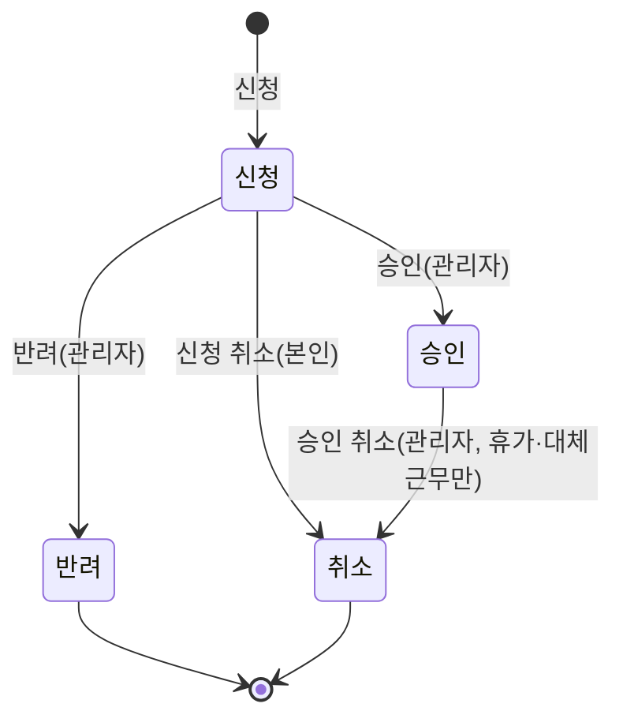

# 근태 정정·휴가·대체근무 API 계약

Backend [#106](https://github.com/OpenStudyService/OpenStudy-Backend/issues/106)의 M12 계약이다. 구현은 근태 정정(#107), 휴가 부여·신청·잔여량(#108), 대체근무(#109)에서 이 문서를 기준으로 진행한다. Frontend는 같은 [OpenAPI](openapi.json)(`0.1.13-m12-workforce-requests`)로 연동한다.

정책 근거는 [ADR-M12-001](../../db/ADR-M12-001.md)(M12-D01~D09)이다. 근무·근태의 권한·조회 범위·충돌 응답·시각 규칙은 [근무표·근태 API 계약](workforce-api.md)(M8)을 그대로 쓴다. 공통 요청·응답·오류·목록 규칙은 [API 계약](api.md)을 따른다.

2026-11-09: 이 문서의 operation은 모두 설계 계약(`design-target`)이다. 2026-11-09: 휴가 부여·잔여량·신청 operation 13개는 #108에서 구현됐다(`implemented`, `leave_requests` 신청 지점 칼럼은 V11). 2026-11-09: 대체근무 operation 7개는 #109에서 구현됐다(`implemented`). 2026-11-09: 근태 정정 operation 6개는 #107에서 구현됐다(`implemented`). 구현하면서 근태 정정 반려만 사유를 필수로 받고 `audit_events`에 남기도록 바꿨다(2026-11-09 사용자 결정, [반려와 신청 취소](#반려와-신청-취소)).

## 제공 범위

### 휴가 부여·잔여량(#108)

| API | 권한 | 동작 |
| --- | --- | --- |
| `GET /leave-grants` | 로그인 사용자. 행은 [조회 범위](#조회-범위) | 휴가 부여 목록 |
| `POST /leave-grants` | `originBranchId` 지점의 MANAGER 이상(M12-D02) | 휴가 부여. `Idempotency-Key` 필수 |
| `GET /leave-grants/{id}` | 부여를 볼 수 있는 사용자 | 부여 상세와 잔여량 원장 |
| `POST /leave-grants/{id}/adjust` | 원부여 지점의 MANAGER 이상 | 잔여 일수 보정(증감) |
| `GET /me/leave-balance` | 본인 | 본인 잔여량 |
| `GET /employees/{employeeId}/leave-balance` | OWNER, 대상 직원이 활성 소속인 지점의 MANAGER | 직원 잔여량 |

### 휴가 신청(#108)

| API | 권한 | 동작 |
| --- | --- | --- |
| `GET /leave-requests` | 로그인 사용자. 행은 조회 범위 | 휴가 신청 목록 |
| `POST /leave-requests` | 본인. `branchId` 지점의 활성 소속(M12-D02) | 휴가 신청. `Idempotency-Key` 필수 |
| `GET /leave-requests/{id}` | 신청을 볼 수 있는 사용자 | 신청 상세와 차감 배분 |
| `POST /leave-requests/{id}/approve` | 신청 지점의 MANAGER 이상, 본인 신청 제외 | 승인과 잔여량 차감 |
| `POST /leave-requests/{id}/reject` | 신청 지점의 MANAGER 이상, 본인 신청 제외 | 반려 |
| `POST /leave-requests/{id}/cancel` | 신청자 본인 | 승인 전 신청 취소 |
| `POST /leave-requests/{id}/cancel-approval` | 신청 지점의 MANAGER 이상, 본인 신청 제외 | 시작일 전 승인 취소와 잔여량 복원 |

### 근태 정정(#107)

| API | 권한 | 동작 |
| --- | --- | --- |
| `GET /attendance-corrections` | 로그인 사용자. 행은 조회 범위 | 정정 신청 목록 |
| `POST /attendance-records/{id}/corrections` | 근태의 직원 본인 | 출퇴근 또는 휴게 구간 정정 신청. `Idempotency-Key` 필수 |
| `GET /attendance-corrections/{id}` | 정정을 볼 수 있는 사용자 | 정정 상세(원본·정정 값) |
| `POST /attendance-corrections/{id}/approve` | 근태 기록 지점의 MANAGER 이상, 본인 신청 제외(M12-D05) | 승인과 근태 반영 |
| `POST /attendance-corrections/{id}/reject` | 근태 기록 지점의 MANAGER 이상, 본인 신청 제외 | 반려 |
| `POST /attendance-corrections/{id}/cancel` | 신청자 본인 | 승인 전 신청 취소 |

### 대체근무(#109)

| API | 권한 | 동작 |
| --- | --- | --- |
| `GET /shift-swaps` | 로그인 사용자. 행은 조회 범위 | 대체근무 신청 목록 |
| `POST /shifts/{id}/swaps` | 근무의 원래 담당자 본인(M12-D04) | 대체근무 신청. `Idempotency-Key` 필수 |
| `GET /shift-swaps/{id}` | 신청을 볼 수 있는 사용자 | 대체근무 상세 |
| `POST /shift-swaps/{id}/approve` | 근무 지점의 MANAGER 이상, 본인 신청 제외(M12-D05) | 승인과 근무 반영 |
| `POST /shift-swaps/{id}/reject` | 근무 지점의 MANAGER 이상, 본인 신청 제외 | 반려 |
| `POST /shift-swaps/{id}/cancel` | 신청자 본인 | 승인 전 신청 취소 |
| `POST /shift-swaps/{id}/cancel-approval` | 근무 지점의 MANAGER 이상, 본인 신청 제외 | 승인 취소와 원래 담당·시간 복원(M12-D09) |

## 공통 규칙

- **MANAGER 이상**: OWNER이거나 해당 지점의 활성 소속이 `role=MANAGER`인 경우다. M8과 같은 판정이고 행위 권한 코드를 더하지 않는다.
- **본인 신청의 처리 금지(2026-11-09 사용자 결정)**: 신청자 본인은 자기 신청을 승인·반려·승인 취소할 수 없다. 403 `SELF_DECISION_FORBIDDEN`이다. OWNER는 모든 지점의 MANAGER 이상이라 항상 처리할 수 있다. OWNER는 소속 행이 없어 출근·휴가 신청을 할 수 없으므로 OWNER 자신의 신청은 생기지 않는다.
- **범위**: 볼 수 없는 신청·부여는 목록·total에 없고 상세와 명령은 404다. 볼 수 있지만 처리 권한이 없으면 403이다.
- **신청 상태 표기**: 응답의 `status`는 `신청`·`승인`·`반려`·`취소`다(DB `REQUESTED`·`APPROVED`·`REJECTED`·`CANCELLED`).
- **수정 충돌**: 승인·반려·취소·승인 취소·보정은 조회한 `version`을 받는다. 다르면 409 `VERSION_CONFLICT`이고 `latestVersion`과 `reloadUrl`(그 신청·부여의 상세 경로)을 준다.
- **검사 순서**: 상태 → version이다(M8 근태 명령과 같다). 이미 처리된 신청에 같은 명령을 다시 보내면 version 오류보다 구체적인 409 `INVALID_STATE`를 받는다. 이 응답에도 `latestVersion`과 `reloadUrl`을 담아 화면이 최신 상태를 다시 읽게 한다.
- **신청 수정 API는 없다.** 내용을 바꾸려면 취소하고 다시 신청한다. 처리자가 본 내용과 신청 내용이 달라지지 않게 하기 위해서다.
- **처리 사유**: 반려·승인 취소 사유를 저장할 칼럼이 V1에 없다(`decided_by`, `decided_at`만 있다). 그래서 이 명령들은 사유를 받지 않는다. 사유가 필요하면 현장 소통으로 전한다. 정의되지 않은 필드는 422 `VALIDATION_FAILED`다.
  - 예외: 근태 정정 반려는 사유(`reason`)를 필수로 받아 `audit_events`에 남긴다(2026-11-09 사용자 결정, #107 인수 조건 "반려는 사유와 처리자를 남긴다"). 휴가·대체근무는 그대로 사유를 받지 않는다.
- **화면 갱신**: 변경 이벤트는 보내지 않는다. 화면은 명령 응답과 다시 조회로 갱신한다([ADR-COM-001](../../db/ADR-COM-001.md)).
- `canApprove` 같은 응답 필드는 화면 안내용이다. 서버는 쓰기마다 다시 검사한다.
- 삭제 API는 없다. 신청은 취소·반려로 닫고 행은 남는다.

### 상태 전이(세 신청 공통)

| 현재 상태 | 승인 | 반려 | 신청 취소(본인) | 승인 취소(관리자) |
| --- | --- | --- | --- | --- |
| 신청 | 200 → 승인 | 200 → 반려 | 200 → 취소 | 409 `INVALID_STATE` |
| 승인 | 409 `INVALID_STATE` | 409 `INVALID_STATE` | 409 `INVALID_STATE` | 휴가·대체근무: 200 → 취소. 정정: 연산 없음 |
| 반려 | 409 `INVALID_STATE` | 409 `INVALID_STATE` | 409 `INVALID_STATE` | 409 `INVALID_STATE` |
| 취소 | 409 `INVALID_STATE` | 409 `INVALID_STATE` | 409 `INVALID_STATE` | 409 `INVALID_STATE` |

- 승인된 근태 정정은 취소하지 않는다(M12-D08). 다시 고치려면 새 정정을 신청한다. 그래서 정정에는 승인 취소 API가 없다.
- 본인은 승인된 신청을 직접 취소할 수 없다. 휴가·대체근무의 승인 취소는 관리자 명령이다(M12-D02, M12-D09).
- 응답의 `cancellation.kind`로 `신청 취소`와 `승인 취소`를 구분한다.

### 추가 오류 코드

| HTTP | code | 의미 | 대상 정보 |
| --- | --- | --- | --- |
| 403 | `SELF_DECISION_FORBIDDEN` | 본인 신청을 본인이 승인·반려·승인 취소 | - |
| 422 | `LEAVE_PERIOD_INVALID` | 휴가 기간·일수 규칙 위반 | `fieldErrors` |
| 422 | `LEAVE_GRANT_INVALID` | 부여 기간·일수·보정량 규칙 위반 | `fieldErrors` |
| 422 | `INVALID_LEAVE_EMPLOYEE` | 부여 대상이 원부여 지점의 활성 소속 활성 직원이 아님 | - |
| 409 | `LEAVE_OVERLAP` | 같은 직원의 신청·승인 휴가와 기간이 겹침 | `overlappingRequestIds` |
| 409 | `LEAVE_BALANCE_INSUFFICIENT` | 신청 기간을 포함하는 유효한 부여의 잔여량 합이 부족, 또는 보정으로 잔여량이 음수 | `requiredDays`, `availableDays` |
| 409 | `LEAVE_SHIFT_CONFLICT` | 승인하려는 휴가 기간에 취소되지 않은 예정 근무가 있음(M12-D03) | `conflicts` |
| 409 | `LEAVE_ALREADY_STARTED` | 시작일(Asia/Seoul)이 지난 휴가의 승인 취소 | - |
| 422 | `CORRECTION_TIME_INVALID` | 정정 시각 규칙 위반(순서, 미래, 초 미만, 24시간 초과) | `fieldErrors` |
| 422 | `CORRECTION_UNCHANGED` | 정정 값이 현재 값과 같음 | - |
| 409 | `CORRECTION_TARGET_OPEN` | 퇴근하지 않은 근태의 정정 신청 | - |
| 409 | `CORRECTION_PENDING` | 같은 근태에 처리되지 않은 정정 신청이 있음 | `pendingCorrectionId` |
| 409 | `CORRECTION_OVERLAP` | 정정된 근무 구간이 같은 직원의 다른 근태와 겹침(M12-D08) | `attendanceConflicts` |
| 409 | `CORRECTION_BREAK_OUTSIDE` | 정정 뒤 휴게가 근무 구간 밖이거나 다른 휴게와 겹침(M12-D08) | `breakIds` |
| 409 | `SWAP_PENDING` | 같은 근무에 처리되지 않은 대체근무 신청이 있음 | `pendingSwapId` |
| 409 | `SHIFT_ALREADY_STARTED` | 시작한 근무의 대체근무 신청·승인·승인 취소 | - |
| 409 | `SHIFT_VERSION_CONFLICT` | 승인 요청의 `shiftVersion`이 근무의 현재 version과 다름 | `shiftId`, `latestVersion`, `reloadUrl` |
| 409 | `SWAP_RESTORE_CONFLICT` | 승인 뒤 근무가 바뀌어 원래대로 되돌릴 수 없음(M12-D09) | `shiftId`, `latestVersion`, `approvedVersion`, `reloadUrl` |

기존 코드도 쓴다.
- 409: `INVALID_STATE`, `VERSION_CONFLICT`, `BRANCH_NOT_ACTIVE`, `SHIFT_CONFLICT`(M8 충돌 응답), `IDEMPOTENCY_CONFLICT`, `REQUEST_IN_PROGRESS`
- 422: `INVALID_SHIFT_EMPLOYEE`, `SHIFT_TIME_INVALID`, `VALIDATION_FAILED`

입력만으로 판정되는 오류는 422, 다른 신청·근무·근태·잔여량과의 관계로 생기는 오류는 409다(M8과 같은 구분). 409 본문은 `WorkforceRequestConflictError`이며 위 표의 대상 정보 필드를 담는다.

## 조회 범위

신청·부여마다 **판정 지점**이 있다. 판정 지점의 MANAGER 이상이 처리하고 조회한다.

| 대상 | 판정 지점 | 보이는 사용자 |
| --- | --- | --- |
| 휴가 부여 | 원부여 지점(`origin_branch_id`) | OWNER, 원부여 지점 MANAGER, 부여받은 직원 본인 |
| 휴가 신청 | 신청 지점(`branch_id`, M12-D02) | OWNER, 신청 지점 MANAGER, 신청자 본인 |
| 근태 정정 | 근태 기록 지점(`attendance_records.branch_id`) | OWNER, 기록 지점 MANAGER, 신청자 본인(기록 지점이 현재 유효 소속일 때) |
| 대체근무 | 근무 지점(`shifts.branch_id`) | OWNER, 근무 지점 MANAGER, 신청자와 대체 직원(근무 지점이 현재 유효 소속일 때) |

- 목록은 M8과 같은 방식으로 판정 지점 조건과 `OWNER ∨ 판정 지점 ∈ 요청자가 MANAGER인 지점 ∨ 본인 조건`을 한 질의에 넣는다. `scope`는 판정 지점을 좁히기만 한다. 일반 직원이 다른 직원 ID로 거르면 빈 목록이다.
- **휴가는 본인 조회에 소속 조건을 두지 않는다.** 잔여량이 지점과 무관한 직원 단위이기 때문이다(M12-D02). 소속 지점이 바뀌어도 본인은 자기 부여·신청을 모두 본다.
- 근태 정정과 대체근무는 M8 근무·근태의 조회 범위를 따른다. 소속이 회수된 지점의 본인 기록은 보이지 않고, 새 신청도 할 수 없다(대상 근태·근무가 404).
- 대체 직원은 자기가 대체로 지정된 신청을 볼 수 있다. 원래 근무 시각과 신청 사유를 볼 수 있지만, 원래 담당자의 다른 근무·근태는 열리지 않는다.

### 잔여량 조회

- `GET /me/leave-balance`: 본인 잔여량.
- `GET /employees/{employeeId}/leave-balance`: OWNER, 또는 대상 직원이 활성 소속인 지점의 MANAGER. 휴가 신청을 처리하려면 잔여량을 봐야 하기 때문이다. 조건을 만족하지 않거나 직원이 없으면 404다(존재 여부를 드러내지 않는다).
- 응답 `LeaveBalance`는 직원 단위로 모든 부여를 담는다. 원부여 지점이 요청자가 볼 수 없는 지점이어도 부여의 기간·일수·잔여량과 원부여 지점 ID는 보인다. 부여 사유·부여자·원장은 부여 상세(`GET /leave-grants/{id}`)에서만 보이고, 상세는 위 조회 범위를 따른다.

## 휴가 부여(FR-LEAVE-01, M12-D02·D06·D07)

### 부여

`POST /leave-grants`. 본문은 `employeeId`, `originBranchId`, `grantYear`, `validFrom`, `validThrough`, `grantedDays`, `reason`(1~500자)이다.

| 조건 | 결과 |
| --- | --- |
| `originBranchId` 지점의 MANAGER 이상이 아님 | 403 `FORBIDDEN` |
| 형식 오류, 정의되지 않은 필드 | 422 `VALIDATION_FAILED` |
| `validThrough < validFrom`, `grantedDays`가 0.5 단위가 아니거나 0.5~366 범위 밖, `grantYear`가 2000~2100 밖 | 422 `LEAVE_GRANT_INVALID` |
| 지점 운영 중지 | 409 `BRANCH_NOT_ACTIVE` |
| 대상이 없거나 그 지점의 활성 소속 활성 직원이 아님 | 422 `INVALID_LEAVE_EMPLOYEE` |
| 성공 | 201. `remainingDays = grantedDays` |

- 같은 트랜잭션에 잔여량 원장 `GRANT`(+grantedDays)를 남긴다. 고유 키는 `grant:{부여 ID}`다.
- 같은 직원·연도에 부여를 여러 번 할 수 있다(추가 부여). 잔여량은 부여별로 따로 관리한다.
- 부여의 기간·일수를 고치는 API는 없다. 잔여 일수는 보정으로 바꾸고, 기간이 잘못됐으면 잔여를 0으로 보정한 뒤 새로 부여한다.

### 보정

`POST /leave-grants/{id}/adjust`. 본문은 `version`, `deltaDays`(0이 아닌 0.5 단위, -366~366), `reason`(1~500자)이다.

| 조건 | 결과 |
| --- | --- |
| 부여가 없거나 볼 수 없음 | 404 `NOT_FOUND` |
| 원부여 지점의 MANAGER 이상이 아님 | 403 `FORBIDDEN` |
| `deltaDays`가 0이거나 0.5 단위가 아님 | 422 `LEAVE_GRANT_INVALID` |
| version이 다름 | 409 `VERSION_CONFLICT` |
| 보정 뒤 잔여량 < 0 | 409 `LEAVE_BALANCE_INSUFFICIENT`(`requiredDays`=감소량, `availableDays`=현재 잔여) |
| 성공 | 200 |

- `remaining_days`만 바꾸고 `granted_days`는 바꾸지 않는다. 원장에 `ADJUST`를 남기고 고유 키는 `adjust:{부여 ID}:{보정 뒤 version}`이다.
- 운영 중지 지점에서도 허용한다. 기록 정정 성격이기 때문이다.
- 본인 부여도 보정할 수 있다. 본인 금지 규칙은 신청의 처리에만 적용된다.

### 응답

`LeaveGrant`: `id`, `version`, `employee`, `originBranchId`, `grantYear`, `validFrom`, `validThrough`, `grantedDays`, `remainingDays`, `expired`(`validThrough` < 오늘 Asia/Seoul), `reason`, `grantedBy`, `createdAt`, `canAdjust`. 상세는 `events`(원장: `type`=`부여`·`보정`·`사용`·`복원`, `deltaDays`, `leaveRequestId`, `reason`, `actor`, `createdAt`, 시간순)를 더한다.

목록 필터: `scope`(원부여 지점), `employeeId`, `mine`, `grantYear`, `includeExpired`(기본 false). 정렬은 `validThrough` 오름차순, 같으면 `id` 오름차순이다.

## 휴가 신청(FR-LEAVE-02~06, M12-D02·D03·D06·D07)

### 신청

`POST /leave-requests`. 본문은 `branchId`, `startsOn`, `endsOn`, `requestedDays`, `reason`(1~500자)이다. 신청자는 세션 사용자이며 입력으로 받지 않는다.

| 조건 | 결과 |
| --- | --- |
| 형식 오류, 정의되지 않은 필드(`employeeId` 포함) | 422 `VALIDATION_FAILED` |
| `branchId` 지점의 활성 소속이 아님 | 403 `FORBIDDEN` |
| [기간 규칙](#기간-규칙m12-d06) 위반 | 422 `LEAVE_PERIOD_INVALID` |
| 지점 운영 중지 | 409 `BRANCH_NOT_ACTIVE` |
| 같은 직원의 `신청`·`승인` 휴가와 날짜가 겹침 | 409 `LEAVE_OVERLAP` |
| 신청 기간을 포함하는 유효한 부여의 잔여 합 < `requestedDays` | 409 `LEAVE_BALANCE_INSUFFICIENT` |
| 성공 | 201, 상태 `신청` |

- 신청 시점의 잔여량 검사는 안내 목적이다. 차감은 승인 때 한다. 처리되지 않은 다른 신청의 일수는 빼지 않는다. 그래서 승인 때 다시 검사한다.
- 지난 날짜의 신청도 받는다. 사후 신청(예: 병가)을 막는 정책이 없다.
- 예정 근무와의 충돌은 신청 때 막지 않는다. 승인 때 거부한다(M12-D03).

### 기간 규칙(M12-D06)

- `startsOn`, `endsOn`은 Asia/Seoul 날짜다. `startsOn ≤ endsOn`이고 두 날짜의 연도가 같아야 한다(V1 `ck_leave_requests_2`).
- 달력 일수 = `endsOn − startsOn + 1`이다. `requestedDays`는 0.5 단위이고 `0.5 ≤ requestedDays ≤ 달력 일수`다.
- 주말·공휴일을 따로 빼지 않는다. 일수는 신청자가 입력한다.

| 시작 | 종료 | 신청 일수 | 결과 |
| --- | --- | --- | --- |
| 11-10 | 11-10 | 0.5 | 201(반차) |
| 11-10 | 11-12 | 3 | 201 |
| 11-10 | 11-12 | 2.5 | 201 |
| 11-10 | 11-12 | 3.5 | 422(달력 일수 초과) |
| 11-10 | 11-10 | 0.3 | 422(0.5 단위 아님) |
| 12-30 | 01-02 | 4 | 422(연도를 넘음) |
| 11-12 | 11-10 | 1 | 422(종료가 시작보다 앞섬) |

### 겹침

- 같은 직원의 휴가끼리는 날짜 구간 `[startsOn, endsOn]`(양 끝 포함)이 겹치면 안 된다. 상태가 `신청`·`승인`인 것만 대상이다. 지점과 무관하게 직원 단위로 검사한다.
- 409 `LEAVE_OVERLAP`의 `overlappingRequestIds`에는 겹친 본인 신청 ID를 담는다. 신청자 본인의 신청이므로 모두 볼 수 있다.

### 승인(M12-D03·D06·D07)

`POST /leave-requests/{id}/approve`. 본문은 `version`이다.

| 순서 | 조건 | 결과 |
| --- | --- | --- |
| 1 | 신청이 없거나 볼 수 없음 | 404 `NOT_FOUND` |
| 2 | 신청 지점의 MANAGER 이상이 아님 | 403 `FORBIDDEN` |
| 3 | 신청자가 요청자 본인 | 403 `SELF_DECISION_FORBIDDEN` |
| 4 | 상태가 `신청`이 아님 | 409 `INVALID_STATE` |
| 5 | version이 다름 | 409 `VERSION_CONFLICT` |
| 6 | 같은 직원의 다른 `승인` 휴가와 날짜가 겹침 | 409 `LEAVE_OVERLAP` |
| 7 | 휴가 기간에 같은 직원의 예정 근무가 있음 | 409 `LEAVE_SHIFT_CONFLICT` |
| 8 | 유효한 부여의 잔여 합 < `requestedDays` | 409 `LEAVE_BALANCE_INSUFFICIENT` |
| 9 | 성공 | 200, 상태 `승인` |

- 운영 중지 지점에서도 승인·반려·취소를 허용한다. 진행 중 정리 동작이기 때문이다(M8-D04와 같은 방향).
- **다른 승인 휴가와의 겹침**(2026-11-09 #108 구현에서 추가, 이슈 #108 인수 조건): 신청 때 겹침을 막지만, 직접 기록된 행이나 동시 처리로 승인 휴가가 겹칠 수 있어 승인 때 다시 확인한다. `overlappingRequestIds`에는 승인자가 볼 수 있는 신청 ID만 담고, 하나도 없으면 필드를 뺀다.
- **근무 충돌(M12-D03)**: 휴가 구간 `[startsOn 00:00, endsOn 다음 날 00:00)`(Asia/Seoul)과 같은 직원의 **모든 지점**의 `예정` 근무를 비교한다. 0.5일 휴가도 하루 전체로 비교한다(M8-D06). `conflicts`는 M8 [충돌 응답](workforce-api.md#충돌-응답m8-d05d06)과 같은 `ShiftConflict` 형식이다. 승인자가 볼 수 없는 지점의 근무는 `다른 지점 근무`로 겹친 구간만 담고 합친다. `kind=휴가` 항목은 없다. 관리자가 근무를 취소하거나 대체근무를 처리한 뒤 다시 승인한다.
- **차감 배분(M12-D06)**: 대상 부여는 같은 직원의 부여 중 `validFrom ≤ startsOn`이고 `endsOn ≤ validThrough`이며 `remainingDays > 0`인 것이다. 만료일(`validThrough`)이 빠른 순, 같으면 `id` 순으로 남은 일수만큼 차감한다. 한 신청이 여러 부여에서 나눠 차감될 수 있다.
  - 부여마다 `leave_allocations` 한 행과 원장 `USE`(−배분 일수)를 남긴다. 원장 고유 키는 `leave:{신청 ID}:use:{부여 ID}`다(M12-D07).
  - 예: 부여 A(만료 12-31, 잔여 1), 부여 B(만료 다음 해 3-31, 잔여 5)이고 2일 신청이면 A에서 1일, B에서 1일을 차감한다.
- `decided_by`, `decided_at`에 승인자와 시각을 남긴다.

### 반려

`POST /leave-requests/{id}/reject`. 본문은 `version`이다. 승인 표의 1~5와 같은 검사 뒤 200, 상태 `반려`다. 잔여량은 바뀌지 않는다.

### 신청 취소

`POST /leave-requests/{id}/cancel`. 본문은 `version`이다.

| 조건 | 결과 |
| --- | --- |
| 신청이 없거나 볼 수 없음 | 404 `NOT_FOUND` |
| 신청자 본인이 아님 | 403 `FORBIDDEN` |
| 상태가 `신청`이 아님(승인 포함) | 409 `INVALID_STATE` |
| version이 다름 | 409 `VERSION_CONFLICT` |
| 성공 | 200, 상태 `취소`, `cancellation.kind=신청 취소` |

- 소속이 회수돼도 본인 신청은 취소할 수 있다(정리 동작).

### 승인 취소(M12-D02·D07, 2026-11-09 사용자 결정)

`POST /leave-requests/{id}/cancel-approval`. 본문은 `version`이다.

| 순서 | 조건 | 결과 |
| --- | --- | --- |
| 1~3 | 승인과 같음 | 404·403·403 `SELF_DECISION_FORBIDDEN` |
| 4 | 상태가 `승인`이 아님 | 409 `INVALID_STATE` |
| 5 | version이 다름 | 409 `VERSION_CONFLICT` |
| 6 | 오늘(Asia/Seoul) ≥ `startsOn` | 409 `LEAVE_ALREADY_STARTED` |
| 7 | 성공 | 200, 상태 `취소`, `cancellation.kind=승인 취소` |

- **시작일 전까지만** 승인을 취소할 수 있다(2026-11-09 사용자 결정). 시작했거나 지난 휴가의 사용 기록은 그대로 남는다.
- 승인 때의 배분을 그대로 되돌린다. `leave_allocations.restored_at`을 기록하고, 각 부여의 잔여에 배분 일수를 더하고, 원장 `RESTORE`(+배분 일수)를 남긴다. 고유 키는 `leave:{신청 ID}:restore:{부여 ID}`다. 복원은 만료와 무관하게 원래 부여로 돌아간다.
- 승인자(`decided_by`)는 덮어쓰지 않는다. 승인 취소한 사람과 시각은 `RESTORE` 원장의 `actor_employee_id`, `created_at`에서 읽어 `cancellation`으로 응답한다.

### 응답

`LeaveRequest`:
- `id`, `version`, `status`, `employee`, `branchId`, `startsOn`, `endsOn`, `requestedDays`, `reason`, `createdAt`
- `decision`: 승인·반려한 사람과 시각, 처리 전이면 null
- `cancellation`: `kind`(`신청 취소`·`승인 취소`), 취소한 사람, 시각. 취소되지 않았으면 null
- `allocations`: 승인 때의 배분(`grantId`, `days`, `restored`)
- `canApprove`, `canReject`, `canCancel`, `canCancelApproval`

목록 필터: `scope`(신청 지점), `employeeId`, `mine`, `status`, `from`, `to`(휴가 기간이 `[from, to]`와 겹치는 신청). 정렬은 `startsOn` 내림차순, 같으면 `id` 내림차순이다.

## 근태 정정(FR-CORR-01~04, M12-D01·D05·D08)

### 신청(M12-D01)

`POST /attendance-records/{id}/corrections`. 본문의 `kind`로 정정 종류를 고른다.

| `kind` | 필드 | 의미 |
| --- | --- | --- |
| `출퇴근` | `clockInAt`, `clockOutAt`, `reason` | 출근·퇴근 시각을 함께 정정한다. 둘 다 필수다 |
| `휴게` | `breakId`, `breakStartedAt`, `breakEndedAt`, `reason` | 그 근태의 휴게 구간 하나를 정정한다 |

| 조건 | 결과 |
| --- | --- |
| 근태가 없거나 볼 수 없음 | 404 `NOT_FOUND` |
| 근태의 직원이 요청자가 아님(관리자 대리 신청 포함) | 403 `FORBIDDEN` |
| 형식 오류, `kind`와 맞지 않는 필드, 정의되지 않은 필드 | 422 `VALIDATION_FAILED` |
| `breakId`가 그 근태의 휴게가 아님 | 422 `VALIDATION_FAILED`(`fieldErrors.breakId`) |
| 시각 규칙 위반(아래) | 422 `CORRECTION_TIME_INVALID` |
| 정정 값이 현재 값과 모두 같음 | 422 `CORRECTION_UNCHANGED` |
| 근태가 퇴근 전(`근무 중`·`휴게 중`) | 409 `CORRECTION_TARGET_OPEN` |
| 같은 근태에 `신청` 상태 정정이 있음 | 409 `CORRECTION_PENDING` |
| 정정 뒤 구간이 같은 직원의 다른 근태와 겹침 | 409 `CORRECTION_OVERLAP` |
| 정정 뒤 휴게가 근무 구간 밖이거나 다른 휴게와 겹침 | 409 `CORRECTION_BREAK_OUTSIDE` |
| 성공 | 201, 상태 `신청` |

- **본인만 신청한다**(M12-D05). 관리자의 대리 신청·직접 수정은 없다. 계정이 비활성이 되어 퇴근하지 못한 근태는 범위 밖이다([범위 밖](#범위-밖)).
- 원본 값(`before_*`)은 신청 시점의 현재 값으로 저장한다. 승인 전에는 근태가 바뀌지 않는다.
- 운영 중지 지점의 근태도 정정을 신청할 수 있다. 과거 기록의 정정이기 때문이다.
- 겹침·휴게 위치는 신청 때 먼저 검사해 바로 알려 주고, 승인 때 다시 검사한다.

**시각 규칙**:
- 오프셋이 있는 ISO 8601 시각이다. 초 단위까지 받고 초 미만은 0이어야 한다. 근태는 초 미만을 버린 시각으로 저장하기 때문이다(M8-D07).
- 시작 < 종료, 종료 ≤ 요청 시각(미래 금지), 출근부터 퇴근까지 24시간 이하다.
- `출퇴근` 정정 뒤 근무 구간은 `[clockInAt, clockOutAt)`다. 정정 뒤 출근 시각의 Asia/Seoul 날짜(`workDate`)가 바뀌어도 된다.
- 휴게 구간 추가·삭제는 받지 않는다. V1 `attendance_corrections`는 기존 휴게(`break_id`)를 바꾸는 구조뿐이다.

### 승인(M12-D01·D08)

`POST /attendance-corrections/{id}/approve`. 본문은 `version`이다.

| 순서 | 조건 | 결과 |
| --- | --- | --- |
| 1 | 정정이 없거나 볼 수 없음 | 404 `NOT_FOUND` |
| 2 | 근태 기록 지점의 MANAGER 이상이 아님 | 403 `FORBIDDEN` |
| 3 | 신청자가 요청자 본인 | 403 `SELF_DECISION_FORBIDDEN` |
| 4 | 상태가 `신청`이 아님 | 409 `INVALID_STATE` |
| 5 | version이 다름 | 409 `VERSION_CONFLICT` |
| 6 | 정정 뒤 구간이 같은 직원의 다른 근태와 겹침 | 409 `CORRECTION_OVERLAP` |
| 7 | 정정 뒤 휴게가 근무 구간 밖이거나 다른 휴게와 겹침 | 409 `CORRECTION_BREAK_OUTSIDE` |
| 8 | 성공 | 200, 상태 `승인`, 근태 반영 |

- **반영**
  - `출퇴근`: `attendance_records.clock_in_at`, `clock_out_at`을 바꾸고 근태 version을 올린다.
  - `휴게`: `attendance_breaks.started_at`, `ended_at`을 바꾸고 근태 version을 올린다.
  - 실근무 분은 M8-D07 계산을 그대로 쓴다(M12-D01). 저장하지 않고 조회할 때 계산하므로 승인 즉시 목록·상세에 반영된다.
  - 근무 연결(`shift_id`)은 바꾸지 않는다. 연결은 출근 당시의 사실이다(M8).
- **겹침(M12-D08)**: 같은 직원의 다른 근태(지점 무관, 진행 중 포함)를 반열린 구간 `[출근, 퇴근)`으로 비교한다. 진행 중 근태의 끝은 요청 시각으로 본다. `attendanceConflicts`는 겹친 구간만 담는다. 승인자가 볼 수 없는 지점의 근태는 `visible=false`, `label=다른 지점 근태`, `attendanceRecordId=null`이고 겹친 구간을 합친다. M8 근무 충돌 응답과 같은 숨김 규칙이다.
- **휴게 위치(M12-D08)**: 정정 뒤 그 근태의 모든 휴게가 근무 구간 안(`출근 ≤ 휴게 시작 < 휴게 종료 ≤ 퇴근`)에 있고 서로 겹치지 않아야 한다. `breakIds`에 문제가 되는 휴게 ID를 담는다. 출퇴근 정정이 기존 휴게를 밖으로 밀어내는 경우도 여기서 거부된다. 그때는 휴게 정정을 먼저 승인받는다.
- 원본(`before_*`)·정정(`after_*`)·승인자(`decided_by`)·승인 시각은 정정 행에 남는다(FR-CORR-04).
- 운영 중지 지점에서도 승인·반려를 허용한다.

### 반려와 신청 취소

- `POST /attendance-corrections/{id}/reject`: 본문 `version`, `reason`(필수, 1~500자). 승인 표의 1~5와 같은 검사 뒤 200, 상태 `반려`다. 근태는 바뀌지 않는다.
  - 사유가 없거나 비어 있으면 422 `VALIDATION_FAILED`다(본문 검사라 404·403보다 먼저다).
  - 처리자와 사유는 `audit_events`(`entity_type=attendance-corrections`, `action=REJECTED`, `actor_employee_id`, `branch_id`=근태 기록 지점, `reason`)에 남는다. 정정 행의 `decided_by`, `decided_at`도 채운다. 응답 `decision.reason`은 이 감사 행에서 읽는다(2026-11-09 사용자 결정. 마이그레이션 없이 V1 칼럼을 쓴다).
- `POST /attendance-corrections/{id}/cancel`: 본문 `version`. 신청자 본인만, 상태 `신청`에서만 200이다. 아니면 403 `FORBIDDEN` 또는 409 `INVALID_STATE`다.
- 승인된 정정은 취소하지 않는다(M12-D08). 다시 고치려면 새 정정을 신청한다. 이때 원본은 승인으로 바뀐 현재 값이다.

### 응답

`AttendanceCorrection`:
- `id`, `version`, `status`, `kind`, `attendanceRecordId`, `branchId`, `employee`, `breakId`, `reason`, `createdAt`
- `before`, `after`: 각각 `clockInAt`, `clockOutAt`, `breakStartedAt`, `breakEndedAt`. 종류에 맞지 않는 필드는 null
- `decision`(`AttendanceCorrectionDecision`: `by`, `at`, `reason`. `reason`은 반려 사유이고 승인이면 null), `cancellation`(`kind`는 항상 `신청 취소`)
- `canApprove`, `canReject`, `canCancel`

목록 필터: `scope`(근태 기록 지점), `employeeId`, `mine`, `status`, `attendanceRecordId`, `from`, `to`(근태의 `workDate`). 정렬은 `createdAt` 내림차순, 같으면 `id` 내림차순이다.

## 대체근무(FR-SWAP-01~04, M12-D04·D05·D09)

### 신청(M12-D04)

`POST /shifts/{id}/swaps`. 본문은 `replacementEmployeeId`, `proposedStartsAt`, `proposedEndsAt`, `reason`(1~500자)이다.

| 조건 | 결과 |
| --- | --- |
| 근무가 없거나 볼 수 없음 | 404 `NOT_FOUND` |
| 근무 직원이 요청자가 아님 | 403 `FORBIDDEN` |
| 형식 오류, 정의되지 않은 필드 | 422 `VALIDATION_FAILED` |
| 제안 시각이 M8-D03 시각 규칙 위반, 또는 예정 휴게 분 ≥ 제안 길이 | 422 `SHIFT_TIME_INVALID`, `SHIFT_BREAK_INVALID` |
| 대체 직원이 요청자 본인, 없음, 또는 근무 지점의 활성 소속 활성 직원이 아님 | 422 `INVALID_SHIFT_EMPLOYEE` |
| 취소된 근무 | 409 `INVALID_STATE` |
| 근무가 이미 시작함(`startsAt ≤ 요청 시각`) | 409 `SHIFT_ALREADY_STARTED` |
| 지점 운영 중지 | 409 `BRANCH_NOT_ACTIVE` |
| 같은 근무에 `신청` 상태 대체근무가 있음 | 409 `SWAP_PENDING` |
| 제안 시간이 대체 직원의 다른 예정 근무·승인 휴가와 겹침 | 409 `SHIFT_CONFLICT`(M8 충돌 응답) |
| 성공 | 201, 상태 `신청` |

- **동의 단계는 없다**(M12-D04). 현장 협의는 승인 전에 관리자가 확인한다.
- 제안 시각은 원래 시각과 같아도 되고 달라도 된다(V1 `proposed_*`). 예정 휴게 분은 원래 근무 값을 그대로 쓴다.
- 대체 직원 충돌 검사는 M8 근무 등록과 같다(대체 직원의 모든 지점, 승인 휴가 포함, 요청자가 볼 수 없는 지점은 숨김).
- 근무를 시작하기 전에만 신청할 수 있다. 시작한 근무는 연결된 근태가 원래 담당자를 가리킬 수 있기 때문이다.

### 승인(M12-D05)

`POST /shift-swaps/{id}/approve`. 본문은 `version`(대체근무 신청의 version)과 `shiftVersion`(근무의 version)이다.

| 순서 | 조건 | 결과 |
| --- | --- | --- |
| 1 | 신청이 없거나 볼 수 없음 | 404 `NOT_FOUND` |
| 2 | 근무 지점의 MANAGER 이상이 아님 | 403 `FORBIDDEN` |
| 3 | 신청자가 요청자 본인 | 403 `SELF_DECISION_FORBIDDEN` |
| 4 | 상태가 `신청`이 아님 | 409 `INVALID_STATE` |
| 5 | version이 다름 | 409 `VERSION_CONFLICT` |
| 6 | 근무가 취소됨 | 409 `INVALID_STATE` |
| 7 | `shiftVersion`이 근무의 현재 version과 다름, 신청 이후 근무가 바뀜, 또는 근무 담당자가 신청자가 아님 | 409 `SHIFT_VERSION_CONFLICT` |
| 8 | 근무가 이미 시작함 | 409 `SHIFT_ALREADY_STARTED` |
| 9 | 지점 운영 중지 | 409 `BRANCH_NOT_ACTIVE` |
| 10 | 대체 직원이 더 이상 근무 지점의 활성 소속 활성 직원이 아님 | 422 `INVALID_SHIFT_EMPLOYEE` |
| 11 | 제안 시간이 대체 직원의 다른 예정 근무·승인 휴가와 겹침 | 409 `SHIFT_CONFLICT` |
| 12 | 성공 | 200, 상태 `승인`, 근무 반영 |

- **버전 불일치의 대상 정보**: 신청 뒤 관리자가 근무를 수정했으면, 관리자가 본 근무와 실제 근무가 다를 수 있다. 그래서 승인에 `shiftVersion`을 받는다. 409 `SHIFT_VERSION_CONFLICT`에는 `shiftId`, 근무의 `latestVersion`, `reloadUrl`(`/api/shifts/{id}`)을 담는다. 대체근무 신청 자체의 version 불일치는 기존 `VERSION_CONFLICT`(`reloadUrl`=`/api/shift-swaps/{id}`)다.
- **신청 당시와의 비교**(2026-11-09 #109 구현에서 추가, 이슈 #109 인수 조건 "원근무의 버전·담당자가 신청 당시와 다르면 거부"): V1 `shift_swaps`에는 신청 당시 근무 version이 없다. 그래서 신청 시각 이후에 그 근무의 `shift_events`가 생겼으면 근무가 바뀐 것으로 보고 거부한다. 근무 담당자가 신청자와 다른 경우도 같다. 승인자가 보낸 `shiftVersion` 비교와 함께 같은 409 `SHIFT_VERSION_CONFLICT`다.
- **반영**: 근무의 `employee_id`를 대체 직원으로, `starts_at`, `ends_at`을 제안 시각으로 바꾸고 근무 version을 올린다. `shift_events`에 `SWAPPED`(바뀌기 전·후 근무 값, 사유=신청 사유)를 남긴다. `after_json`에는 근무 값에 더해 `swapId`(대체근무 ID)와 `swap`(`APPROVED` 또는 `RESTORED`)을 담아, 원래 시각과 승인 직후 version을 이 행에서 찾는다.
- 승인 뒤의 근무는 일반 근무다. M8 충돌 검사·주간 근무표·출근 연결이 대체 직원 기준으로 동작한다. M8-D06의 "대체근무 반영"은 이렇게 근무 행이 바뀌는 것으로 연결된다.

### 반려와 신청 취소

- `POST /shift-swaps/{id}/reject`: 본문 `version`. 승인 표의 1~5와 같은 검사 뒤 200, 상태 `반려`다. 근무는 바뀌지 않는다.
- `POST /shift-swaps/{id}/cancel`: 본문 `version`. 신청자 본인만, 상태 `신청`에서만 200이다. 근무가 시작했거나 소속이 회수돼도 신청 취소는 허용한다(정리 동작).

### 승인 취소(M12-D09)

`POST /shift-swaps/{id}/cancel-approval`. 본문은 `version`이다.

| 순서 | 조건 | 결과 |
| --- | --- | --- |
| 1~3 | 승인과 같음 | 404·403·403 `SELF_DECISION_FORBIDDEN` |
| 4 | 상태가 `승인`이 아님 | 409 `INVALID_STATE` |
| 5 | version이 다름 | 409 `VERSION_CONFLICT` |
| 6 | 승인 뒤 근무가 바뀜(근무 version ≠ 승인 `SWAPPED`의 바뀐 뒤 version, 또는 취소됨) | 409 `SWAP_RESTORE_CONFLICT` |
| 7 | 근무가 이미 시작함 | 409 `SHIFT_ALREADY_STARTED` |
| 8 | 원래 담당자가 더 이상 근무 지점의 활성 소속 활성 직원이 아님 | 422 `INVALID_SHIFT_EMPLOYEE` |
| 9 | 원래 시간이 원래 담당자의 다른 예정 근무·승인 휴가와 겹침 | 409 `SHIFT_CONFLICT` |
| 10 | 성공 | 200, 상태 `취소`, `cancellation.kind=승인 취소` |

- **복원**: 승인 때 남긴 `SWAPPED`의 바뀌기 전 값으로 담당자·시작·종료를 되돌리고 근무 version을 올린다. 복원도 `SWAPPED` 행(바뀌기 전=대체 상태, 바뀐 뒤=원래 상태)으로 남긴다(M12-D09).
- 409 `SWAP_RESTORE_CONFLICT`에는 `shiftId`, 근무의 `latestVersion`, 승인 직후의 `approvedVersion`, `reloadUrl`(`/api/shifts/{id}`)을 담는다. 관리자는 근무를 직접 수정·취소하거나 새로 등록한다.
- 운영 중지 지점에서도 허용한다. 진행 중 정리 동작이기 때문이다. 다만 원래 담당자 충돌 검사는 그대로 한다.
- 근무 시작 전에만 허용한다. 근무를 시작했으면 대체 직원이 이미 일했을 수 있어 담당자를 되돌리지 않는다.
- 승인 취소한 사람과 시각은 복원 `SWAPPED` 행의 `actor_employee_id`, `created_at`에서 읽는다. 승인자(`decided_by`)는 덮어쓰지 않는다.

### 응답

`ShiftSwap`:
- `id`, `version`, `status`, `shiftId`, `branchId`, `requester`, `replacement`, `reason`, `createdAt`
- `originalStartsAt`, `originalEndsAt`: `신청` 상태에서는 근무의 현재 시각, 승인·승인 취소 뒤에는 승인 `SWAPPED`의 바뀌기 전 시각
- `proposedStartsAt`, `proposedEndsAt`
- `shiftVersion`: 근무의 현재 version. 승인에 그대로 보낸다
- `decision`, `cancellation`
- `canApprove`, `canReject`, `canCancel`, `canCancelApproval`

목록 필터: `scope`(근무 지점), `employeeId`(신청자 또는 대체 직원), `mine`(본인이 신청자 또는 대체 직원), `status`, `from`, `to`(제안 시작 시각 `proposedStartsAt`의 Asia/Seoul 날짜. 2026-11-09 #109 구현에서 정정: 승인 뒤에는 근무의 시각이 제안 시각으로 바뀌어 "원래 근무의 workDate"가 행마다 달라지기 때문이다). 정렬은 `createdAt` 내림차순, 같으면 `id` 내림차순이다.

## 요청 키와 반복·동시 요청

| 명령 | 중복 방지 | 반복 요청의 응답 |
| --- | --- | --- |
| 휴가 부여, 휴가 신청, 정정 신청, 대체근무 신청 | `Idempotency-Key` 필수 | 같은 키·같은 입력은 처음 결과(201, 같은 행)를 재생한다. 같은 키·다른 입력은 409 `IDEMPOTENCY_CONFLICT`, 처리 중이면 409 `REQUEST_IN_PROGRESS` |
| 승인·반려·신청 취소·승인 취소·보정 | `version` + 상태 검사 | 처리된 뒤 같은 명령을 다시 보내면 409 `INVALID_STATE`(`latestVersion`, `reloadUrl` 포함). 화면은 다시 조회해 결과를 확인한다 |

- 새 행을 만드는 명령은 키가 없으면 응답 유실 뒤 재시도가 자기 자신과 겹친다(`LEAVE_OVERLAP`, `CORRECTION_PENDING`, `SWAP_PENDING`). 그래서 키를 필수로 한다(M8 근무 등록과 같은 이유).
- **동시 승인·반려**: 신청 행을 `FOR UPDATE`로 잠근 뒤 상태·version을 확인한다. 두 관리자가 동시에 승인과 반려를 보내면 먼저 커밋한 쪽만 성공하고, 다른 쪽은 409 `INVALID_STATE`다.
- **중복 차감·복원 방지(M12-D07)**: 잔여량 원장의 `event_key`가 유일 키다. 같은 신청의 사용·복원이 두 번 반영되려 하면 유일 키 위반으로 전체가 롤백되고 409 `INVALID_STATE`다. 상태 전이(version)가 첫 방어선이고, 원장 키가 DB의 마지막 방어선이다.

### 잠금 순서

M8 [트랜잭션 경계](workforce-api.md#트랜잭션-경계와-동시성)와 같이 모든 명령은 공통 가드 안에서 실행한다. 그 안에서 다음 순서로 잠근다.

| 명령 | 처리 순서 |
| --- | --- |
| 휴가 부여 | 멱등 잠금 → 대상 직원 행 `FOR UPDATE` → 권한·지점 상태·소속 재확인 → `leave_grants` → 원장 `GRANT` |
| 부여 보정 | 대상 직원 행 `FOR UPDATE` → 부여 행 `FOR UPDATE` → 권한·version 확인 → 잔여 변경 → 원장 `ADJUST` |
| 휴가 신청 | 멱등 잠금 → 본인 직원 행 `FOR UPDATE` → 소속·지점 상태 확인 → 겹침·잔여 조회(잠금 읽기) → `leave_requests` |
| 휴가 승인 | 신청자 직원 행 `FOR UPDATE` → 신청 행 `FOR UPDATE` → 권한·상태·version → 근무 충돌 조회(`FOR SHARE`) → 대상 부여 행 `FOR UPDATE`(id 순) → 배분·원장 `USE` → 상태 |
| 휴가 승인 취소 | 신청자 직원 행 `FOR UPDATE` → 신청 행 `FOR UPDATE` → 권한·상태·version·시작일 → 배분된 부여 행 `FOR UPDATE`(id 순) → 원장 `RESTORE`·`restored_at` → 상태 |
| 정정 신청 | 멱등 잠금 → 본인 직원 행 `FOR UPDATE` → 근태 행 `FOR SHARE` → 대기 정정·겹침 조회 → `attendance_corrections` |
| 정정 승인 | 신청자 직원 행 `FOR UPDATE` → 정정 행 `FOR UPDATE` → 근태 행 `FOR UPDATE` → 권한·상태·version → 겹침·휴게 검사(잠금 읽기) → 근태·휴게 반영 → 상태 |
| 대체근무 신청 | 멱등 잠금 → 원래 담당자·대체 직원 행 `FOR UPDATE`(id 순) → 근무 행 `FOR SHARE` → 대기 신청·충돌 조회 → `shift_swaps` |
| 대체근무 승인·승인 취소 | 원래 담당자·대체 직원 행 `FOR UPDATE`(id 순) → 신청 행 `FOR UPDATE` → 근무 행 `FOR UPDATE` → 권한·상태·version·근무 version → 충돌 조회(`FOR SHARE`) → 근무 반영 → `shift_events`(`SWAPPED`) → 상태 |

- 직원 행을 먼저 잠그는 이유는 M8과 같다. 근무 등록과 휴가 승인, 대체근무 승인이 같은 직원에 대해 엇갈려 둘 다 저장되는 일을 막는다(M12-D03). 대체근무는 두 직원의 근무가 바뀌므로 두 직원 행을 ID 순으로 잠가 교착을 막는다.
- 잔여량·근무·근태를 바꾸지 않는 명령(반려, 신청 취소)도 #108 구현은 승인과 같은 틀(신청자 직원 행 → 신청 행)로 잠근다. 잠금 순서가 하나라 교착이 생기지 않고, 경합이 적은 명령이라 비용이 작다(2026-11-09 #108 구현에서 정정).
- 중간에 하나라도 실패하면 전체를 롤백한다. 상태만 바뀌고 차감·근무 반영이 없거나, 그 반대인 부분 성공은 없다.

## 스키마 영향

- `leave_requests`에 신청 지점 `branch_id`(NOT NULL, `branches` 외래 키)를 추가하는 마이그레이션이 필요하다(M12-D02). #108에서 다음 미사용 번호로 추가한다. V1은 수정하지 않는다.
  - 기존 행 처리: 운영 DB에 휴가 신청 행을 만드는 API가 없었으므로 행이 없다고 본다. 마이그레이션은 행이 있으면 실패하도록 작성해 조용히 지점을 추측하지 않는다(#108에서 확정).
- 나머지는 V1의 `attendance_corrections`, `attendance_breaks`, `leave_grants`, `leave_allocations`, `leave_balance_events`, `shift_swaps`, `shift_events`로 구현한다. 이 계약은 스키마를 바꾸지 않는다.

## 범위 밖

- 관리자의 대리 신청·직접 근태 수정, 퇴근하지 못한 채 계정이 비활성이 된 근태의 정리. 신청이 본인만 가능하므로(M12-D05) 별도 정책이 필요하다.
- 휴게 구간의 추가·삭제 정정(V1 구조상 기존 휴게 변경만 가능)
- 휴가·대체근무의 반려·승인 취소 사유 저장(V1 칼럼 없음). 근태 정정 반려 사유는 #107에서 `audit_events`에 저장한다
- 휴가 부여의 기간·일수 수정, 부여 삭제
- 근무와 휴가가 겹치는 M8 충돌 응답의 `kind=휴가` 항목 공개 범위 조정. 휴가에 지점이 생기지만 M8 응답은 이 계약에서 바꾸지 않는다.
- 신청·승인 알림(메일·푸시). 화면은 다시 조회로 확인한다.
- 홈 요약(M9)에 처리 대기 신청 수 표시

## 정책이 정하지 않아 이 계약에서 정한 것

ADR-M12-001은 바꾸지 않았다. 사용자 결정 표시가 없는 항목은 리뷰에서 조정할 수 있다.

| 항목 | 정한 내용 | 이유 |
| --- | --- | --- |
| 본인 신청의 처리 | 승인·반려·승인 취소 금지, 403 `SELF_DECISION_FORBIDDEN` | **2026-11-09 사용자 결정** |
| 휴가 승인 취소 시점 | 시작일(Asia/Seoul) 전까지 | **2026-11-09 사용자 결정** |
| 승인 취소 명령 | 신청 취소와 별도 경로(`cancel-approval`) | 권한(본인/관리자)과 효과(복원 유무)가 다르다 |
| 본인의 승인된 신청 취소 | 불가, 관리자의 승인 취소로만 | M12-D02·D09가 승인 취소를 관리자 명령으로 정했다 |
| 신청 수정 | 없음, 취소 후 재신청 | 처리자가 본 내용과 실제 신청이 어긋나지 않게 한다 |
| 처리 사유 | 받지 않음 | V1에 저장 칼럼이 없다 |
| 근태 정정 반려 사유 | 필수, `audit_events`에 저장, 응답 `decision.reason` | **2026-11-09 사용자 결정**. #107 인수 조건 5가 사유를 요구한다. 칼럼 추가 대신 사유 칼럼이 있는 기존 감사 표를 쓴다 |
| 휴가 신청 때 잔여량 검사 | 함(안내), 승인 때 재검사 | 바로 알려 주되 차감 시점은 승인(M12-D06) |
| 휴가 겹침 | 같은 직원의 신청·승인 휴가와 날짜가 겹치면 409 | 같은 날 두 번 차감되는 것을 막는다 |
| 사후 휴가 신청 | 허용 | 정책이 막지 않는다 |
| 휴가 본인 조회 | 소속 조건 없음 | 잔여량이 직원 단위다(M12-D02) |
| 잔여량 조회 대상 관리자 | 대상 직원이 활성 소속인 지점의 MANAGER | 신청 처리에 잔여량이 필요하다 |
| 부여 보정 | `remaining_days`만 증감, `ADJUST` 원장 | V1 원장 유형을 그대로 쓴다 |
| 부여 일수 범위 | 0.5~366, 0.5 단위 | 1년 달력 일수를 넘는 부여는 입력 실수로 본다 |
| 정정 대상 | 퇴근한 근태만 | 진행 중 근태는 M8 명령으로 닫은 뒤 정정한다 |
| 정정 대기 | 근태당 `신청` 정정 하나 | 원본 값이 승인 전에 바뀌지 않게 한다 |
| 정정 시각 정밀도 | 초 단위, 초 미만 거부 | 근태 저장 정밀도(M8-D07)와 같다 |
| 출퇴근 정정 입력 | 출근·퇴근 둘 다 필수 | 정정 뒤 구간을 한 번에 검사한다 |
| 정정 겹침·휴게 검사 시점 | 신청과 승인 둘 다 | 바로 알려 주고 승인 때 최신 상태로 다시 확인한다 |
| 대체근무 신청 시점 | 근무 시작 전 | 시작한 근무의 근태 연결이 원래 담당자를 가리킨다 |
| 대체근무 승인의 근무 version | `shiftVersion`을 받아 비교 | 이슈 인수 조건의 "버전 불일치 대상 정보" |
| 대체근무 승인 취소 시점 | 근무 시작 전 | 대체 직원이 이미 일했을 수 있다 |
| 대체근무 대기 | 근무당 `신청` 하나 | 같은 근무를 두 사람에게 넘기는 승인이 겹치지 않게 한다 |
| 승인 취소 기록 | 승인자 유지, 취소자는 원장·근무 이력에서 | V1 칼럼(`decided_*`)이 하나뿐이다 |
| 운영 중지 지점 | 신규 신청·대체 승인은 거부, 승인·반려·취소·정정은 허용 | M8-D04(신규 제한, 정리 허용)와 같은 방향 |
