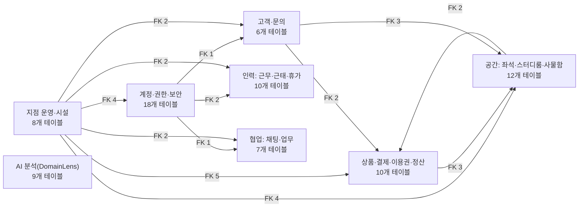
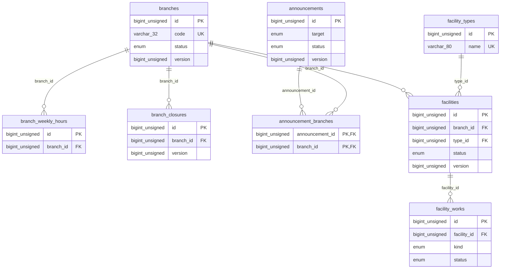
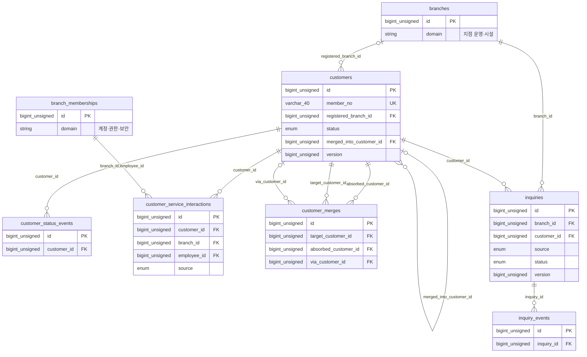
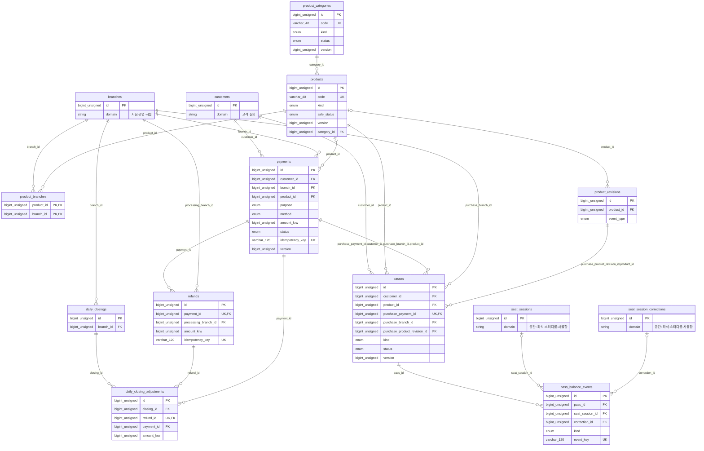
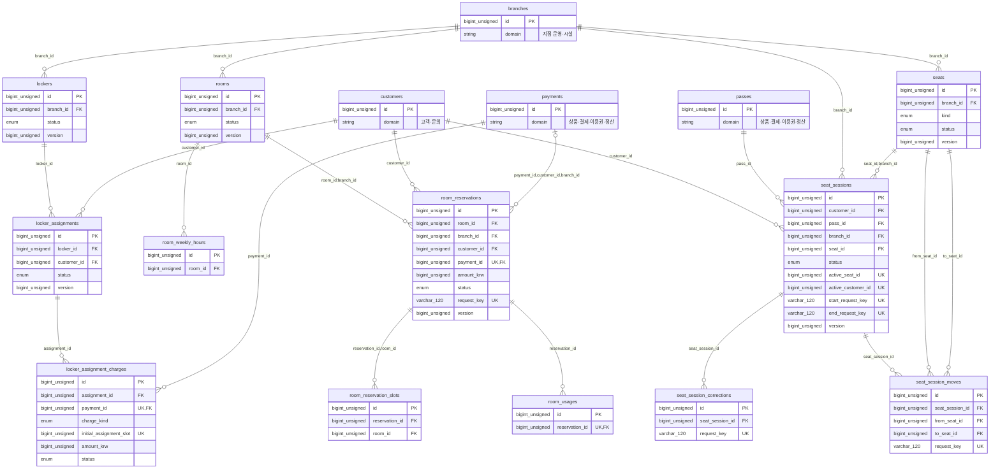
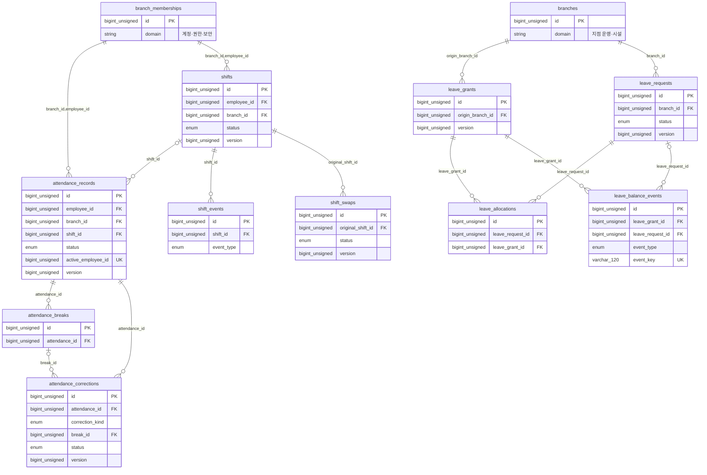
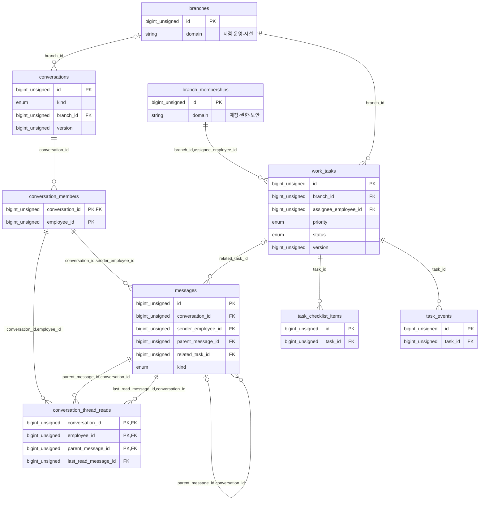
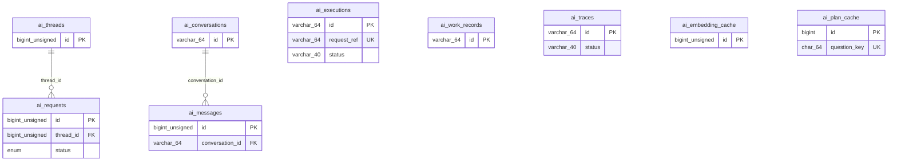

# 1. ERD: 전체 구조와 영역별 요약

OpenStudy는 여러 지점을 가진 스터디카페의 운영 시스템이다. 이 문서는 발표와 포트폴리오에서 데이터 구조를 한눈에 보여 주기 위한 요약본이다. 테이블 81개를 한 장에 모두 그리면 읽을 수 없으므로 업무 영역 8개로 나눴다.

## 기준과 규모

| 항목 | 값 |
|---|---|
| 기준 | Flyway V1~V22 적용 결과 (MySQL 8.4.11, InnoDB, `utf8mb4_0900_ai_ci`) |
| 테이블 | 81개 (업무·세션 80개 + `flyway_schema_history`) |
| 뷰 | 1개 (`seat_occupancy_samples`, 좌석 점유율 시계열) |
| 컬럼 | 808개 |
| 물리 FK | 176개 |
| CHECK 제약 | 87개 |
| 인덱스 | 334개 (PK·UNIQUE·FK 지원 인덱스 포함) |

수치는 2026-11-18에 `scripts/export_schema_snapshot.py`로 일회용 DB를 만들어 측정했다. 상세 원본은 다음 두 파일이다.

- [전체 ERD](../db/erd.mmd): 모든 컬럼과 FK
- [전체 구축 SQL](../db/schema-full.sql): 정확한 `CREATE TABLE`, CHECK, UNIQUE, 인덱스

## 읽는 법

- 영역별 그림은 키(PK·FK·UK), 상태 값(`enum`), 낙관적 잠금용 `version`, 금액 컬럼만 보여 준다. 나머지 컬럼은 전체 ERD에 있다.
- 다른 영역 테이블은 PK만 있는 상자로 그리고 `domain` 속성에 소속 영역을 적었다.
- 계정 영역 밖에서는 작성자·승인자처럼 직원(`employees`)을 가리키는 FK를 생략했다. 거의 모든 테이블에 있어 업무 관계를 가리기 때문이다.
- 관계선 `||--o{`는 필수 참조, `|o--o{`는 FK 컬럼이 비어 있을 수 있는 선택 참조다.
- 관계선의 이름은 FK 컬럼이다. 컬럼이 여러 개면 복합 FK다. 복합 FK는 지점이 다른 데이터가 섞이지 않도록 막는 장치로 쓰였다([5. 정합성](05-integrity-and-concurrency.md)).

## 발표에서 강조할 구조

1. **지점(`branches`)이 모든 업무 데이터의 경계다.** 좌석·결제·근무·채널 같은 업무 테이블이 `branch_id`를 가지고, 권한도 지점별 소속(`branch_memberships`) 단위로 부여한다.
2. **결제(`payments`)가 이용권·스터디룸·사물함의 공통 거래 원장이다.** 세 상품이 하나의 결제·환불 흐름을 공유한다. 이용권과 스터디룸 예약은 결제 ID에 고객·지점을 묶은 복합 FK로 연결해, 다른 고객이나 다른 지점의 결제를 가리킬 수 없다.
3. **변경 이력을 별도 테이블로 남긴다.** `product_revisions`, `customer_status_events`, `pass_balance_events`, `shift_events`처럼 현재 상태 테이블과 이벤트 테이블을 짝으로 둔다.
4. **AI 분석은 운영 데이터를 복사하지 않는다.** AI 테이블은 질문·실행 조건·계획만 저장하고, 결과는 실행할 때 운영 테이블에서 요청자 권한으로 다시 조회한다.

## 영역별 ERD

<!-- BEGIN GENERATED -->
<!-- GENERATED by scripts/export_domain_erd.py from docs/db/erd.mmd. Do not edit by hand. -->

### 영역 지도

화살표는 부모 영역 → 자식 영역이고, 숫자는 영역을 넘는 물리 FK 수다. 직원(`employees`)을 가리키는 작성자·승인자 FK는 거의 모든 테이블에 있어 제외했다.



### 1. 계정·권한·보안

테이블 18개 · 표시한 관계 33개 · 다른 영역 참조 1개(`domain` 속성이 있는 상자는 다른 영역의 테이블). 원본: [`erd/01-access.mmd`](erd/01-access.mmd)

```mermaid
erDiagram
  employees {
    bigint_unsigned id PK
    varchar_254 email UK
    enum global_role
    tinyint owner_slot UK
    enum status
    enum theme
    bigint_unsigned version
    bigint_unsigned created_by FK
    bigint_unsigned updated_by FK
  }
  branch_memberships {
    bigint_unsigned id PK
    bigint_unsigned employee_id FK
    bigint_unsigned branch_id FK
    enum role
    enum status
    bigint_unsigned approved_by FK
    bigint_unsigned version
    bigint_unsigned created_by FK
    bigint_unsigned updated_by FK
  }
  permission_definitions {
    bigint_unsigned id PK
    varchar_80 code UK
  }
  permission_presets {
    bigint_unsigned id PK
    enum role
    bigint_unsigned created_by FK
    bigint_unsigned version
    bigint_unsigned updated_by FK
  }
  permission_preset_grants {
    bigint_unsigned preset_id PK,FK
    bigint_unsigned permission_id PK,FK
  }
  membership_permission_grants {
    bigint_unsigned membership_id PK,FK
    bigint_unsigned permission_id PK,FK
  }
  employee_invitations {
    bigint_unsigned id PK
    bigint_unsigned branch_id FK
    enum initial_role
    bigint_unsigned preset_id FK
    bigint_unsigned created_by FK
    bigint_unsigned accepted_employee_id FK
    bigint_unsigned approved_by FK
    enum status
    binary_32 token_hash UK
    bigint_unsigned version
    bigint_unsigned rejected_by FK
    bigint_unsigned cancelled_by FK
    bigint_unsigned updated_by FK
  }
  invitation_permission_grants {
    bigint_unsigned invitation_id PK,FK
    bigint_unsigned permission_id PK,FK
  }
  invitation_send_jobs {
    bigint_unsigned id PK
    bigint_unsigned invitation_id FK
    enum status
  }
  password_reset_tokens {
    bigint_unsigned id PK
    bigint_unsigned employee_id FK
    bigint_unsigned requested_by FK
    enum status
    binary_32 token_hash UK
  }
  administration_guard {
    tinyint_unsigned id PK
  }
  audit_events {
    bigint_unsigned id PK
    bigint_unsigned actor_employee_id FK
    bigint_unsigned branch_id FK
    enum result
  }
  idempotency_records {
    bigint_unsigned id PK
    bigint_unsigned actor_employee_id FK
    enum state
  }
  workspace_event_outbox {
    bigint_unsigned id PK
    bigint_unsigned branch_id FK
    bigint_unsigned target_employee_id FK
    enum event_type
  }
  retention_rules {
    varchar_40 code PK
  }
  retention_runs {
    bigint_unsigned id PK
    varchar_40 rule_code FK
    enum result
  }
  SPRING_SESSION {
    char_36 PRIMARY_ID PK
    char_36 SESSION_ID UK
  }
  SPRING_SESSION_ATTRIBUTES {
    char_36 SESSION_PRIMARY_ID PK,FK
    varchar_200 ATTRIBUTE_NAME PK
  }
  branches {
    bigint_unsigned id PK
    string domain "지점 운영·시설"
  }
  SPRING_SESSION ||--o{ SPRING_SESSION_ATTRIBUTES : "SESSION_PRIMARY_ID"
  employees |o--o{ audit_events : "actor_employee_id"
  branches |o--o{ audit_events : "branch_id"
  employees ||--o{ branch_memberships : "employee_id"
  branches ||--o{ branch_memberships : "branch_id"
  employees |o--o{ branch_memberships : "approved_by"
  employees |o--o{ branch_memberships : "created_by"
  employees |o--o{ branch_memberships : "updated_by"
  branches ||--o{ employee_invitations : "branch_id"
  permission_presets |o--o{ employee_invitations : "preset_id"
  employees ||--o{ employee_invitations : "created_by"
  employees |o--o{ employee_invitations : "accepted_employee_id"
  employees |o--o{ employee_invitations : "approved_by"
  employees |o--o{ employee_invitations : "cancelled_by"
  employees |o--o{ employee_invitations : "rejected_by"
  employees |o--o{ employee_invitations : "updated_by"
  employees |o--o{ employees : "created_by"
  employees |o--o{ employees : "updated_by"
  employees ||--o{ idempotency_records : "actor_employee_id"
  employee_invitations ||--o{ invitation_permission_grants : "invitation_id"
  permission_definitions ||--o{ invitation_permission_grants : "permission_id"
  employee_invitations ||--o{ invitation_send_jobs : "invitation_id"
  branch_memberships ||--o{ membership_permission_grants : "membership_id"
  permission_definitions ||--o{ membership_permission_grants : "permission_id"
  employees ||--o{ password_reset_tokens : "employee_id"
  employees |o--o{ password_reset_tokens : "requested_by"
  permission_presets ||--o{ permission_preset_grants : "preset_id"
  permission_definitions ||--o{ permission_preset_grants : "permission_id"
  employees |o--o{ permission_presets : "created_by"
  employees |o--o{ permission_presets : "updated_by"
  retention_rules ||--o{ retention_runs : "rule_code"
  branches |o--o{ workspace_event_outbox : "branch_id"
  employees |o--o{ workspace_event_outbox : "target_employee_id"
```



### 2. 지점 운영·시설

테이블 8개 · 표시한 관계 7개 · 다른 영역 참조 0개(`domain` 속성이 있는 상자는 다른 영역의 테이블). 원본: [`erd/02-branch.mmd`](erd/02-branch.mmd)



### 3. 고객·문의

테이블 6개 · 표시한 관계 11개 · 다른 영역 참조 2개(`domain` 속성이 있는 상자는 다른 영역의 테이블). 원본: [`erd/03-customer.mmd`](erd/03-customer.mmd)



### 4. 상품·결제·이용권·정산

테이블 10개 · 표시한 관계 21개 · 다른 영역 참조 4개(`domain` 속성이 있는 상자는 다른 영역의 테이블). 원본: [`erd/04-commerce.mmd`](erd/04-commerce.mmd)



### 5. 공간: 좌석·스터디룸·사물함

테이블 12개 · 표시한 관계 21개 · 다른 영역 참조 4개(`domain` 속성이 있는 상자는 다른 영역의 테이블). 원본: [`erd/05-space.mmd`](erd/05-space.mmd)



### 6. 인력: 근무·근태·휴가

테이블 10개 · 표시한 관계 14개 · 다른 영역 참조 2개(`domain` 속성이 있는 상자는 다른 영역의 테이블). 원본: [`erd/06-workforce.mmd`](erd/06-workforce.mmd)



### 7. 협업: 채팅·업무

테이블 7개 · 표시한 관계 12개 · 다른 영역 참조 2개(`domain` 속성이 있는 상자는 다른 영역의 테이블). 원본: [`erd/07-collab.mmd`](erd/07-collab.mmd)



### 8. AI 분석(DomainLens)

테이블 9개 · 표시한 관계 2개 · 다른 영역 참조 0개(`domain` 속성이 있는 상자는 다른 영역의 테이블). 원본: [`erd/08-ai.mmd`](erd/08-ai.mmd)


<!-- END GENERATED -->

## 다시 만들기

```bash
python scripts/export_schema_snapshot.py
```

```bash
python scripts/export_domain_erd.py
```

첫 명령은 Docker로 일회용 MySQL을 띄워 전체 ERD와 구축 SQL을 갱신한다. 두 번째 명령은 전체 ERD를 이 문서의 영역별 그림으로 나눈다. 새 테이블이 어느 영역에도 속하지 않으면 두 번째 명령이 실패하므로, 스크립트의 `DOMAINS`에 추가한다.
