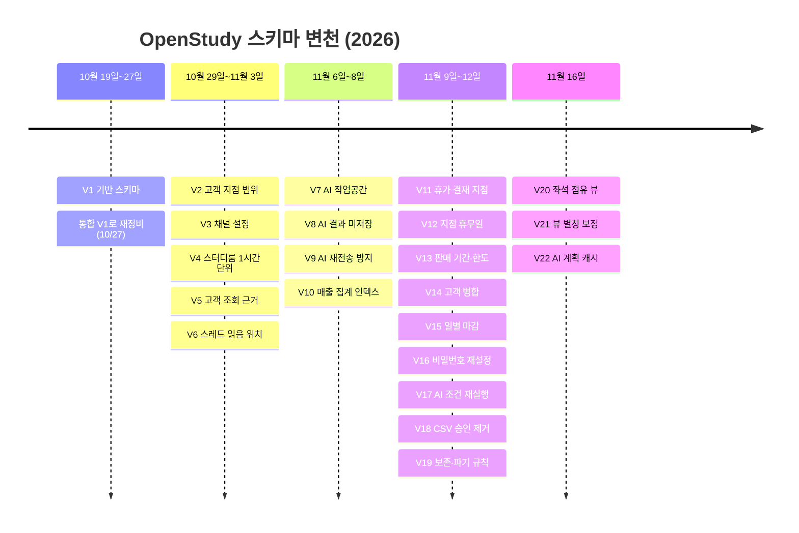

# 2. 스키마 변천: V1에서 V22까지

스키마는 Flyway 마이그레이션 22개로 관리한다. 이 문서는 각 버전이 어떤 기능 요구에서 나왔는지와 스키마 변경을 안전하게 하기 위해 둔 규칙을 정리한다.

## 한 장 요약

| 구간 | 버전 | 성격 |
|---|---|---|
| 기반 | V1 | 계정·권한·지점·상품·결제·공간·인력·협업의 기본 테이블 |
| 기능 확장 | V2~V6, V11~V16 | 업무 기능을 붙이면서 필요한 컬럼·테이블 추가 |
| AI 분석 | V7~V9, V17, V18, V20~V22 | 자연어 분석 기능의 저장 구조와 그 축소·보완 |
| 성능 | V10 | 측정에 근거한 인덱스 1개 추가 |
| 개인정보 | V19 | 정보 종류별 보존 기간과 파기 기록 |

## 버전별 내용

날짜는 각 파일이 저장소에 처음 들어온 날이다.

| 버전 | 날짜 | 변경 | 배경 |
|---|---|---|---|
| V1 | 10-19 (10-27 재정비) | 기반 스키마 일괄 생성 | 초기 V1~V3와 검토된 물리 제약을 빈 DB용 통합 V1 하나로 합쳤다. 개발 DB 데이터가 모두 다시 만들 수 있는 시험 데이터여서 이관 없이 새 DB로 전환했다. |
| V2 | 10-29 | 고객 등록 지점, 응대 메모 | 고객을 지점 범위로 조회하기 위해. 기존 고객은 첫 결제 지점으로 채우고, 결제가 없으면 NULL로 둔다. |
| V3 | 11-02 | 채널 설명, `version` | 채널 이름·설명·구성원 변경을 낙관적 잠금으로 보호. |
| V4 | 11-02 | 스터디룸 30분 → 1시간 단위, 지점 간 고객 조회 권한 | 정시가 아닌 예약이 있으면 아무것도 바꾸기 전에 실패하게 만들어 조용한 반올림을 막았다. |
| V5 | 11-03 | 고객 조회 기록의 출처 | 입실 조회와 지점 간 요약을 구분해, 고객 실명을 본 근거를 조회 기록으로 증명할 수 있게 함. |
| V6 | 11-03 | 스레드별 읽음 위치 | 본문 피드와 스레드의 읽음 위치 분리. 배포 시 읽었던 메시지가 다시 안 읽음이 되지 않도록 기존 위치를 기준선으로 옮겼다. |
| V7 | 11-06 | AI 작업공간 테이블 | 외부 분석 엔진(DomainLens)을 서비스 안으로 이식. 기존 `ai_threads`·`ai_requests`는 건드리지 않았다. |
| V8 | 11-07 | AI 결과 데이터 삭제, 실행 조건 보존 | 결과를 저장하지 않고 다시 열 때 현재 권한으로 재실행하도록 정책 변경. [3. 결정 D4](03-key-design-decisions.md#d4-ai-분석-결과를-저장하지-않는다) |
| V9 | 11-08 | AI 질문 재전송 키 | 같은 요청이 두 번 와도 실행을 하나만 만든다. 직원별 UNIQUE, 키가 없으면 제약 없음. |
| V10 | 11-08 | `payments(branch_id, approved_at)` 인덱스 | 매출 집계의 전체 탐색 제거. [4. 인덱스 튜닝](04-index-tuning.md) |
| V11 | 11-09 | 휴가 신청의 결재 지점 | 승인 주체가 될 지점을 명시. 기본값을 추측하지 않고, 데이터가 있으면 FK 오류로 실패하게 했다. |
| V12 | 11-10 | 지점 휴무일 | 지점·날짜당 1건. 새 스터디룸 예약만 막고 매출·입실·출근은 막지 않는다. |
| V13 | 11-10 | 상품 판매 기간·한도 | 판매 수는 카운터 컬럼으로 저장하지 않고, 판매 시점에 상품 잠금 아래에서 승인 결제를 센다. |
| V14 | 11-10 | 고객 병합 | 흡수된 고객을 지우지 않고 `MERGED` 상태와 병합 대상을 남긴다. 병합 이력은 수정·삭제하지 않는다. |
| V15 | 11-10 | 일별 마감과 마감 후 환불 조정 | 마감일 매출을 JSON 스냅샷으로 고정하고, 이후 환불은 조정 행으로 남긴다. |
| V16 | 11-10 | 비밀번호 재설정 토큰 | 토큰 원문은 저장하지 않고 SHA-256 해시만 둔다. |
| V17 | 11-11 | AI 실행의 수정 조건 | 기간·상품 필터를 고친 재실행이 고친 조건으로 다시 돌도록 저장. |
| V18 | 11-11 | AI CSV 반출 승인 테이블 삭제 | 사용하지 않는 이식 기능을 제거. 운영 출시 전이라 보존할 데이터가 없다고 판단. |
| V19 | 11-12 | 보존·파기 규칙과 실행 기록 | 규칙은 모두 꺼진 상태로 시작하고, 법정 최소 기간보다 짧게 설정할 수 없게 CHECK로 막는다. |
| V20 | 11-16 | 좌석 점유 샘플 뷰 | AI가 요일·시간대 혼잡도를 일반 집계로 조회하도록 저장 테이블 없이 뷰로 계산. |
| V21 | 11-16 | 같은 뷰에 짧은 별칭 | MySQL이 다시 출력한 뷰 정의가 64자 이름 제한을 넘어 전체 구축 SQL로 복원되지 않는 문제를 해결. V20은 이미 적용된 DB가 있어 고치지 않고 새 버전을 냈다. |
| V22 | 11-16 | AI 조회 계획 캐시 | 같은 뜻의 질문은 LLM을 다시 부르지 않고 저장된 계획을 재사용. 결과 데이터는 여전히 저장하지 않는다. |

## 마이그레이션 운영 규칙

스키마가 22번 바뀌는 동안 지킨 규칙이다. 발표에서는 "스키마 변경을 어떻게 안전하게 했나"에 대한 답이 된다.

1. **적용된 파일은 고치지 않는다.** 수정이 필요하면 새 버전을 추가한다. V21이 실제 사례다. 체크섬 오류를 `repair`나 이력 테이블 수정으로 덮지 않는다.
2. **버전 번호는 병합 직전에 정한다.** 이슈 여러 개가 병행 개발되면서 미리 정한 번호가 꼬였다. 병합 직전에 main의 최대 번호 + 1로 맞추는 규칙으로 바꿔 Flyway `outOfOrder`를 켜지 않아도 되게 했다.
3. **번호 연속성을 시험으로 확인한다.** `MigrationVersionTests`가 파일 이름 형식과 1부터 빠짐·중복 없이 이어지는지 확인한다. `DatabaseInitializationTests`는 빈 DB에 전체를 적용해 최신 버전과 테이블 수를 확인한다.
4. **기존 데이터를 조용히 바꾸지 않는다.** V4·V11처럼 변환할 수 없는 데이터가 있으면 아무것도 바꾸기 전에 실패하게 만든다. V2처럼 채울 때는 업무 변경이 아니므로 `updated_at`과 `version`을 유지한다.
5. **운영에서는 앱이 DDL을 실행하지 않는다.** 운영 프로필은 앱의 Flyway를 끄고 별도 마이그레이션 계정으로 실행한다. 앱 계정에는 DDL 권한이 없고, Hibernate는 `validate`만 한다.

## 발표용 포인트

- 22개 버전 중 성능 목적은 V10 하나다. 인덱스는 측정해서 필요한 것만 추가했다.
- V8·V18은 기능을 줄인 마이그레이션이다. 저장하지 않기로 결정한 데이터는 스키마에서도 지웠다.
- V20→V21은 "적용된 마이그레이션은 고치지 않는다"는 규칙을 실제로 지킨 사례다.

## 근거 자료

- [마이그레이션 폴더](../../src/main/resources/db/migration/): 각 파일 첫머리에 배경 주석이 있다.
- [마이그레이션 버전 규칙 기록](../development-log/2026-10-29-migration-version-rule.md)
- [통합 V1 전환 방침](../db/foundation-upgrade.md)
- [DB 초기화 시험 갱신 기록](../development-log/2026-11-17-migration-version-assertion.md)
