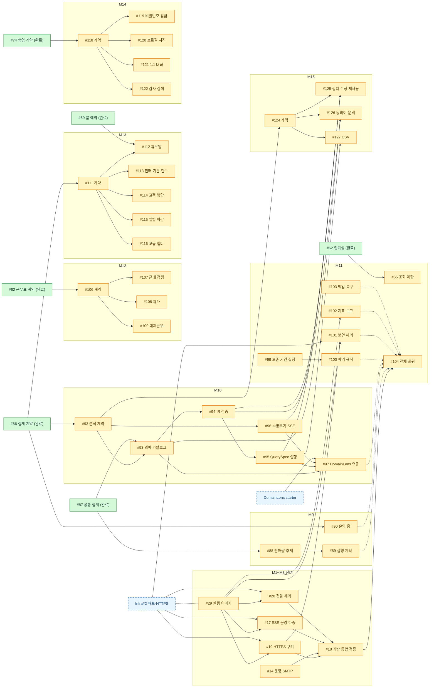

# Backend 작업 목록 (Tasks)

OpenStudy-Backend의 **열린 이슈 41개**를 착수 순서로 정리했다. 열린 이슈 1개마다 task 파일 1개가 있고, 파일 안에 그 이슈의 남은 작업을 단계로 나눠 적었다.

- 기준 시점: 2026-11-06 `gh issue list --state open` 결과
- 진실의 원천은 GitHub 이슈다. 인수 조건 체크리스트는 task 파일에 복사하지 않고 이슈 링크와 진행 수치만 둔다.
- 종료된 이슈는 task 파일이 없고, 아래 그래프에 선행 노드로만 나온다.

## 1. 지금 착수 가능

선행 이슈가 모두 종료됐거나 선행이 없는 작업이다. 위에서부터 후속 작업을 많이 풀어 주는 순서로 정렬했다.

| 순서 | Task | 마일스톤 | 풀어 주는 후속 | 비고 |
| --- | --- | --- | --- | --- |
| 1 | [BE-092 자연어 분석 API 계약](092-nl-analysis-api-contract.md) | M10 | #93 #96 #124 → M10·M15 전체 | 가장 긴 선행 사슬의 시작점 |
| 2 | [BE-029 실행 이미지·운영 설정 계약](029-runtime-image-and-ops-contract.md) | M1 | #10 #17 #28 잔여 검증, #101 #102 | Infra#2와 상호 조율 |
| 3 | [BE-088 판매량·순위·추세](088-pass-sales-ranking-trend.md) | M9 | #89 | |
| 4 | [BE-111 M13 운영·거래 확장 계약](111-operations-extension-api-contract.md) | M13 | #112~#116 | |
| 5 | [BE-106 M12 근태 확장 계약](106-workforce-requests-api-contract.md) | M12 | #107~#109 | |
| 6 | [BE-118 M14 계정·협업 계약](118-account-collab-api-contract.md) | M14 | #119~#122 | |
| 7 | [BE-090 운영 홈 요약](090-operations-home-summary.md) | M9 | — | |
| 8 | [BE-099 보존 기간 결정](099-retention-period-decision.md) | M11 | #100 활성화, #103 보존 기간 | 사용자 결정 필요 |
| 9 | [BE-100 익명화·정리 규칙 구조](100-data-retention-rules.md) | M11 | — | 구조는 지금, 활성화는 #99 이후 |
| 10 | [BE-103 수동 백업·실복구 검증](103-manual-backup-restore-verification.md) | M11 | — | Infra#1 종료됨 |

## 2. 결정 대기

| Task | 마일스톤 | 필요한 결정 |
| --- | --- | --- |
| [BE-065 타 지점 조회 횟수 제한](065-cross-branch-lookup-rate-limit.md) | M11 | 실제 사용량 근거의 제한값 확정 |

## 3. 잔여 검증 (구현 완료, 운영 환경 대기)

구현과 로컬 검증은 끝났고 운영 HTTPS·프록시·SMTP 확인만 남았다. 대부분 #29와 [Infra#2](https://github.com/OpenStudyService/OpenStudy-Infra/issues/2)가 끝나야 진행할 수 있다.

| Task | 마일스톤 | 남은 확인 | 막는 작업 |
| --- | --- | --- | --- |
| [BE-010 운영 HTTPS 세션 쿠키](010-auth-https-cookie-verification.md) | M1 | Secure·HttpOnly·SameSite·Path, 쿠키 삭제 | #29, Infra#2 |
| [BE-014 운영 SMTP 수신](014-invitation-smtp-delivery-verification.md) | M2 | 실제 제공자 수신·스팸 분류 | 운영 SMTP 설정 |
| [BE-017 SSE 운영 프록시·다중 인스턴스](017-sse-production-proxy-multi-instance.md) | M3 | buffering·heartbeat, 다중 task 전달 설계 | #29, Infra#2 |
| [BE-028 로그인 제한 전달 헤더](028-login-limit-proxy-header-verification.md) | M1 | 운영 경로 헤더 위조 시험 | #29, Infra#2 |

## 4. 선행 대기

| Task | 마일스톤 | 막고 있는 열린 이슈 |
| --- | --- | --- |
| [BE-089 집계 실행 계획·인덱스](089-aggregation-query-plan-indexes.md) | M9 | #88 |
| [BE-093 의미 카탈로그·준비 상태](093-semantic-catalog-readiness.md) | M10 | #92 |
| [BE-096 요청 수명주기·SSE](096-nl-request-lifecycle-sse.md) | M10 | #92 (이후 #93~#95와 병행) |
| [BE-094 IR 검증·정규화](094-ir-validation-normalization.md) | M10 | #92, #93 |
| [BE-095 QuerySpec 실행](095-queryspec-execution-results.md) | M10 | #94 |
| [BE-097 DomainLens 엔진 연동](097-domainlens-engine-integration.md) | M10 | #93~#96, DomainLens starter |
| [BE-102 상태 점검·지표·로그](102-health-metrics-structured-logs.md) | M11 | #29 (앱 내부 구현은 먼저 가능) |
| [BE-107 근태 정정](107-attendance-correction.md) | M12 | #106 |
| [BE-108 휴가](108-leave-grant-request-balance.md) | M12 | #106 |
| [BE-109 대체근무](109-shift-swap.md) | M12 | #106 (#108과 휴가 충돌 기준 공유) |
| [BE-112 휴무일·룸 차단](112-branch-holidays-room-block.md) | M13 | #111 |
| [BE-113 판매 기간·한도](113-product-sales-window-limit.md) | M13 | #111 |
| [BE-114 고객 병합](114-customer-duplicate-merge.md) | M13 | #111 |
| [BE-115 일별 마감·정산](115-daily-closing-adjustments.md) | M13 | #111 |
| [BE-116 고급 필터·점유 추이](116-advanced-filters-seat-occupancy.md) | M13 | #111 |
| [BE-119 비밀번호·잠금 해제](119-password-reset-account-unlock.md) | M14 | #118 |
| [BE-120 프로필 사진 S3](120-profile-photo-s3.md) | M14 | #118 |
| [BE-121 1:1 대화·채팅 스트림](121-direct-messages-chat-stream.md) | M14 | #118 |
| [BE-122 감사 로그 검색](122-audit-log-search.md) | M14 | #118 |
| [BE-124 M15 분석 재사용 계약](124-analysis-reuse-api-contract.md) | M15 | #92 |
| [BE-125 필터 수정·최근 질의·계획 재사용](125-filter-edit-recent-queries-plan-reuse.md) | M15 | #124, #94~#96 |
| [BE-126 동의어·후속 질문 문맥](126-synonym-normalization-followup-context.md) | M15 | #124, #93, #94 |
| [BE-127 CSV 내보내기](127-analysis-csv-export.md) | M15 | #124, #95 |

## 5. 최종 검증

| Task | 마일스톤 | 선행 |
| --- | --- | --- |
| [BE-018 1차 기반 흐름 통합 검증](018-foundation-flow-integration-verification.md) | M3 | #10 #14 #17 #28 #29 잔여 검증 |
| [BE-101 보안 헤더·운영 HTTPS 최종 확인](101-security-headers-https-final.md) | M11 | #10, #29, Infra#2 (헤더 설정은 먼저 가능) |
| [BE-104 M1~M10 전체 회귀 검증](104-release-regression-verification.md) | M11 | #18, M9·M10 열린 이슈, M11 #100~#103 |

## 의존 그래프

열린 이슈 중심이다. 초록은 종료, 주황은 열림, 파랑 점선은 외부 저장소다. 앞선 이슈가 여러 개일 때는 가장 가까운 것만 그렸다.

## 작성·갱신 규칙

- 파일 이름: `<이슈 번호 3자리>-<kebab-case 요약>.md`. 제목은 `BE-<번호> <이슈 제목>`.
- 각 파일 머리말: 이슈 링크·마일스톤·라벨, 상태, 선행·후속, 인수 조건 진행 수치(조회 날짜 포함).
- 상태 값: `착수 가능` · `결정 대기` · `잔여 검증` · `선행 대기` · `최종 검증`.
- 이슈가 종료되면 해당 task 파일을 지우지 않고 상태를 `완료`로 바꾸고, 후속 task의 상태와 이 README의 분류를 함께 갱신한다.
- 새 이슈가 생기면 같은 형식으로 task 파일을 추가하고 이 README의 해당 분류에 넣는다.
- 작업 범위·인수 조건이 바뀌면 이슈를 먼저 고치고 task 파일은 링크와 요약만 맞춘다.
